## 13.3 Right pyramids, right cones and spheres (EMA7Q)

<Callout type="info" title="Definition: Pyramid">
A pyramid is a geometric solid that has a polygon as its base and faces that converge at a point called the
          apex. In other words the faces are not perpendicular to the base.
</Callout>

The triangular pyramid and square pyramid take their names from the shape of their base. We call a pyramid a
      “right pyramid” if the line between the apex and the centre of the base is perpendicular to the base.
      Cones are similar to pyramids except that their bases are circles instead of polygons. Spheres are solids that are
      perfectly round and look the same from any direction.

Examples of a square pyramid, a triangular pyramid, a cone and a sphere:

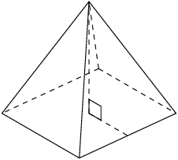

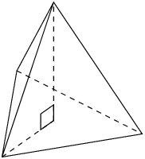

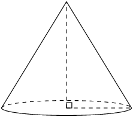

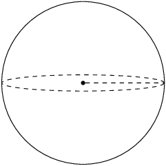

### Surface area of pyramids, cones and spheres (EMA7R)

| Square pyramid |  | \(\begin{array}{rl}
              \text{Surface area} & = \text{area of base } + \\
              & \text{area of triangular sides} \\
              & = {b}^{2} + 4\left(\frac{1}{2}b{h}_{s}\right) \\
              & = b\left(b + 2{h}_{s}\right)
              \end{array}\) |
| --- | --- | --- |
| Triangular pyramid |  | \(\begin{array}{rl}
              \text{Surface area} & = \text{area of base } +\\
              & \text{area of triangular sides}\\
              & = \left(\frac{1}{2}b\times {h}_{b}\right) + 3\left(\frac{1}{2}b\times {h}_{s}\right)\\
              & = \frac{1}{2}b\left({h}_{b} + 3{h}_{s}\right)
              \end{array}\) |
| Right cone |  | \(\begin{array}{rl}
              \text{Surface area}& = \text{area of base } +\\
              & \text{area of walls} \\
              & = \pi {r}^{2} + \frac{1}{2}\times 2\pi rh\\
              & = \pi r\left(r + h\right)
              \end{array}\) |
| Sphere |  | \(\text{Surface area} = 4\pi {r}^{2}\) |

<Callout type="tip" title="Worked example 8: Finding the surface area of a triangular pyramid">
**Question:**
Find the surface area of the following triangular pyramid (correct to one decimal place):

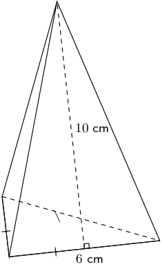

**Find the area of the base:**
\(\text{area of base triangle}=\frac{1}{2}b{h}_{b}\)

To find the height of the base triangle \(\left({h}_{b}\right)\) we use the theorem of Pythagoras:

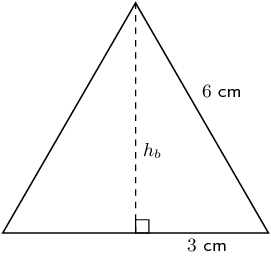

**Find the area of the sides:**
\begin{align*}
          \text{area of sides} & =3\left(\frac{1}{2}\times b\times {h}_{s}\right) \\
          & = 3\left(\frac{1}{2}\times 6\times 10\right) \\
          & = \text{90}\text{ cm$^{2}$}
          \end{align*}

**Find the sum of the areas:**
\begin{align*}
          9\sqrt{3} + 90 & = \text{105,6}\text{ cm$^{2}$}
          \end{align*}

**Write the final answer:**
The surface area of the triangular pyramid is \(\text{105,6}\) \(\text{cm$^{2}$}\).
</Callout>

<Callout type="tip" title="Worked example 9: Finding the surface area of a cone">
**Question:**
Find the surface area of the following cone (correct to 1 decimal place):

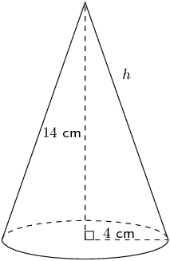

**Find the area of the base:**
\begin{align*}
          \text{area of base circle} & =\pi {r}^{2} \\
          & =\pi \times {4}^{2} \\
          & =16\pi
          \end{align*}

**Find the area of the walls:**
\[\text{area of sides} =\pi rh\]

To find the slant height, \(h\), we use the theorem of Pythagoras:

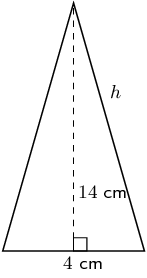

**Find the sum of the areas:**
\begin{align*}
          \text{total surface area} & = 16\pi + 8\pi \sqrt{53} \\
          & = \text{233,2}\text{ cm$^{2}$}
          \end{align*}

**Write the final answer:**
The surface area of the cone is \(\text{233,2}\) \(\text{cm$^{2}$}\).
</Callout>

<Callout type="tip" title="Worked example 10: Finding the surface area of a sphere">
**Question:**
Find the surface area of the following sphere (correct to 1 decimal place):

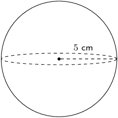

\begin{align*}
        \text{surface area of sphere}& =4\pi {r}^{2} \\
        & =4\pi {(5)}^{2} \\
        & =100\pi \\
        & = \text{314,2}\text{ cm$^{2}$}
        \end{align*}
</Callout>

<Callout type="tip" title="Worked example 11: Examining the surface area of a cone">
**Question:**
If a cone has a height of \(h\) and a base of radius \(r\), show that the surface area is:

\(\pi {r}^{2} + \pi r\sqrt{{r}^{2} + {h}^{2}}\)

**Sketch and label the cone:**
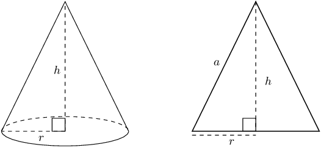

**Identify the faces that make up the cone:**
The cone has two faces: the base and the walls. The base is a circle of radius \(r\) and the walls can be
            opened out to a sector of a circle:

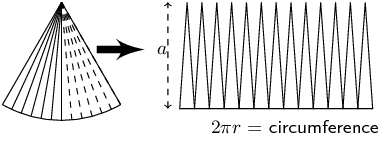

This curved surface can be cut into many thin triangles with height close to \(a\) (where \(a\) is the
            slant height). The area of these triangles or sectors can be summed as follows:

          \begin{align*}
          \text{Area of sector} & = \frac{1}{2}\times \text{base}\times \text{height (of a small triangle)} \\
          & =\frac{1}{2}\times 2\pi r\times a \\
          & =\pi ra
          \end{align*}

**Calculate \(a\):**
\(a\) can be calculated using the theorem of Pythagoras:

          \[a = \sqrt{{r}^{2} + {h}^{2}}\]

**Calculate the area of the circular base (\({A}_{b}\)):**
\[{A}_{b} = \pi {r}^{2}\]

**Calculate the area of the curved walls (\({A}_{w}\)):**
\begin{align*}
          {A}_{w}& =\pi ra \\
          & =\pi r\sqrt{{r}^{2}+{h}^{2}}
          \end{align*}

**Find the sum of the areas \(A\):**
\begin{align*}
          A& ={A}_{b}+{A}_{w} \\
          & =\pi {r}^{2}+\pi r\sqrt{{r}^{2}+{h}^{2}} \\
          & =\pi r\left(r+\sqrt{{r}^{2}+{h}^{2}}\right)
          \end{align*}
</Callout>

### Textbook Exercise 13.4

Find the total surface area of the following objects (correct to 1 decimal place if necessary):

**Problem:**
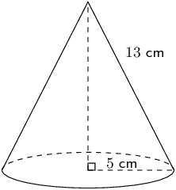

**Solution:**
\begin{align*}
                \text{Surface area} &= \text{area of base} + \text{area of walls}\\
                & = \pi r(r + h_s)\\
                & = \pi (5)(5 + 13) \\
                & \approx \text{282,7}\text{cm$^{2}$}
                \end{align*}

**Problem:**

**Solution:**
We first need to find \(h_b\) by constructing the vertical (perpendicular) height and using the
                  theorem of Pythagoras:

                \begin{align*}
                (h_b)^2 &= (b)^2 - \left(\frac{b}{2}\right)^2 \\
                & = 6^{2} - \left(\frac{6}{2}\right)^{2} \\
                &= 36 - 9 \\
                &= 27 \\
                h_b &= \sqrt{27}~\text{cm}
                \end{align*}

Now we can find the surface area:

                \begin{align*}
                \text{surface area} &= \text{area of base} + \text{area of triangular sides}\\
                & =\frac{1}{2}b(h_{b} + 3h_{s})\\
                & =\frac{1}{2}(6)(\sqrt{27} + 10)\\
                & \approx \text{45,6}\text{ cm$^{2}$}
                \end{align*}

**Problem:**
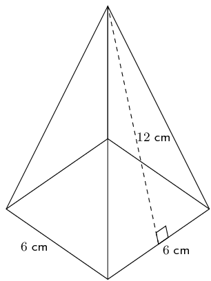

**Solution:**
\begin{align*}
                \text{surface area} &= \text{area of base} + \text{area of triangular sides}\\
                &= b(b + 2h_{s})\\
                &= 6(6 + 2(12)) \\
                &= \text{180}\text{ cm$^{2}$}
                \end{align*}

**Problem:**
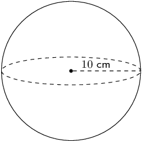

**Solution:**
\begin{align*}
                \text{surface area} &= 4 \pi r^2 \\
                & = 4 \pi (10)^2 \\
                & \approx \text{1 256,6}\text{ cm$^{2}$}
                \end{align*}

**Problem:**
The figure here is a cone. The vertical height of the cone is \(H = \text{9,16}\) units and the slant
                height of the cone is \(h = \text{10}\) units; the radius of the cone is shown, \(r = \text{4}\) units.
                Calculate the surface area of the figure. Round your answer to two decimal places.

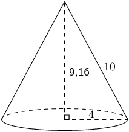

**Solution:**
\begin{align*}
              A_{\text{cone}} & = \pi r(r + h) \\
              & = \pi (\text{4})(\text{4} + \text{10}) \\
              & = \text{56} \pi \\
              & = \text{175,9291...}
              \end{align*}

Therefore the surface area for the cone is \(\text{175,93}\) square units.

**Problem:**
The figure here is a sphere. The radius of the sphere is \(r = \text{8}\) units. Calculate the surface
                area of the figure. Round your answer to two decimal places.

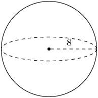

**Solution:**
\begin{align*}
              A_{\text{sphere}} & = \text{4}\pi r^{2} \\
              & = \text{4}\pi (\text{8})^{2} \\
              & = \text{256} \pi \\
              & = \text{804,2477...}
              \end{align*}

Therefore the surface area is \(\text{804,25}\) square units.

**Problem:**
The figure here shows a pyramid with a square base. The sides of the base are each \(\text{7}\) units
                long. The vertical height of the pyramid is \(\text{9,36}\) units, and the slant height of the pyramid
                is \(\text{10}\) units. Determine the surface area of the pyramid.

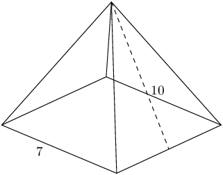

**Solution:**
\begin{align*}
              A_{\text{square pyramid}} & = b(b + 2h_{s}) \\
              & = (7)(7 + 2(10)) \\
              & = \text{189}
              \end{align*}

The surface area for the pyramid is \(\text{189}\) square units.

### Volume of pyramids, cones and spheres (EMA7S)

| Square pyramid |  | \(\begin{array}{rl}
              \text{Volume}& = \frac{1}{3}\times \text{area of base} \times \\
              & \text{height of pyramid}\\
              & = \frac{1}{3}\times {b}^{2}\times H
              \end{array}\) |
| --- | --- | --- |
| Triangular pyramid |  | \(\begin{array}{rl}
              \text{Volume} & = \frac{1}{3}\times \text{area of base} \times \\
              & \text{height of pyramid}\\
              & = \frac{1}{3} \times \frac{1}{2}bh \times H
              \end{array}\) |
| Right cone |  | \(\begin{array}{rl}
              \text{Volume}& = \frac{1}{3}\times \text{area of base} \times \\
              & \text{height of cone}\\
              & = \frac{1}{3}\times \pi {r}^{2}\times H
              \end{array}\) |
| Sphere |  | \(\text{Volume}=\frac{4}{3}\pi {r}^{3}\) |

<Callout type="tip" title="Multimedia & Video">
This video gives an example of calculating the volume of a sphere.

<VideoPlayer src="https://www.youtube.com/embed/IelS2vg7JO8" title="Video: 2GST" />
</Callout>

<Callout type="tip" title="Worked example 12: Finding the volume of a square pyramid">
**Question:**
Find the volume of a square pyramid with a height of 3 cm and a side length of 2 cm.

**Sketch and label the pyramid:**
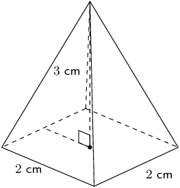

**Select the correct formula and substitute the given values:**
\[V = \frac{1}{3}\times {b}^{2}\times H\]

We are given \(b=2\) and \(H=3\), therefore

          \begin{align*}
          V & = \frac{1}{3}\times {2}^{2}\times 3 \\
          & = \frac{1}{3}\times 12 \\
          & = \text{4}\text{ cm$^{3}$}
          \end{align*}

**Write the final answer:**
The volume of the square pyramid is \(\text{4}\) \(\text{cm$^{3}$}\).
</Callout>

<Callout type="tip" title="Worked example 13: Finding the volume of a triangular pyramid">
**Question:**
Find the volume of the following triangular pyramid (correct to 1 decimal place):

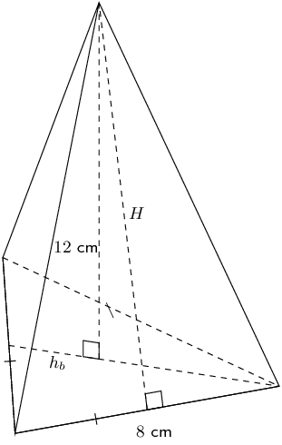

**Sketch the base triangle and calculate its area:**
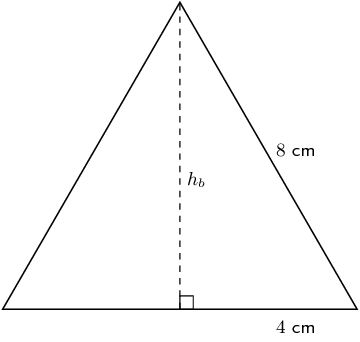

The height of the base triangle (\({h}_{b}\)) is:

          \begin{align*}
          {8}^{2}& ={4}^{2}+{h}_{b}^{2} \\
          \therefore {h}_{b}& =\sqrt{{8}^{2}-{4}^{2}} \\
          & = 4\sqrt{3}~\text{cm}
          \end{align*}

The area of the base triangle is:

          \begin{align*}
          \text{ area of base triangle}& =\frac{1}{2}b\times {h}_{b} \\
          & =\frac{1}{2}\times 8\times 4\sqrt{3} \\
          & =16\sqrt{3} ~\text{cm$^{2}$}
          \end{align*}

**Sketch the side triangle and calculate pyramid height \(H\):**
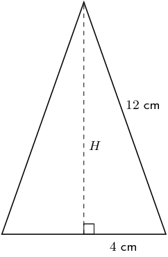

**Calculate the volume of the pyramid:**
\begin{align*}
          V & = \frac{1}{3}\times \frac{1}{2}b{h}_{b} \times H \\
          & = \frac{1}{3} \times 16\sqrt{3}\times \sqrt{130} \\
          & = \text{105,3}\text{ cm$^{3}$}
          \end{align*}

**Write the final answer:**
The volume of the triangular pyramid is \(\text{105,3}\) \(\text{cm$^{3}$}\).
</Callout>

<Callout type="tip" title="Worked example 14: Finding the volume of a cone">
**Question:**
Find the volume of the following cone (correct to \(\text{1}\) decimal place):

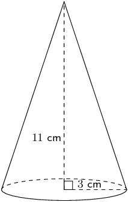

**Find the area of the base:**
\begin{align*}
          \text{area of circle}& =\pi {r}^{2} \\
          & = \pi \times {3}^{2} \\
          & = 9\pi ~\text{cm$^{2}$}
          \end{align*}

**Calculate the volume:**
\begin{align*}
          V & =\frac{1}{3}\times \pi {r}^{2}\times H \\
          & = \frac{1}{3}\times 9\pi \times 11 \\
          & = \text{103,7}\text{ cm$^{3}$}
          \end{align*}

**Write the final answer:**
The volume of the cone is \(\text{103,7}\) \(\text{cm$^{3}$}\).
</Callout>

<Callout type="tip" title="Worked example 15: Finding the volume of a sphere">
**Question:**
Find the volume of the following sphere (correct to 1 decimal place):

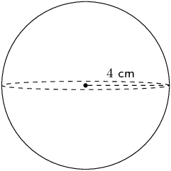

**Use the formula to find the volume:**
\begin{align*}
          \text{volume}& =\frac{4}{3}\pi {r}^{3} \\
          & =\frac{4}{3}\pi {\left(4\right)}^{3} \\
          & = \text{268,1}\text{ cm$^{3}$}
          \end{align*}

**Write the final answer:**
The volume of the sphere is \(\text{268,1}\) \(\text{cm$^{3}$}\).
</Callout>

<Callout type="tip" title="Worked example 16: Finding the volume of a complex object">
**Question:**
A triangular pyramid is placed on top of a triangular prism, as shown below. The base of the prism is an
            equilateral triangle of side length \(\text{20}\) \(\text{cm}\) and the height of the prism is \(\text{42}\)
            \(\text{cm}\). The pyramid has a height of \(\text{12}\) \(\text{cm}\). Calculate the total volume of the
            object.

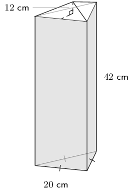

**Calculate the volume of the prism:**
First find the height of the base triangle using the theorem of Pythagoras:

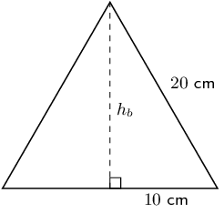

Next find the area of the base triangle:

          \begin{align*}
          \text{area of base triangle} & = \frac{1}{2}\times 20\times 10\sqrt{3} \\
          & = 100\sqrt{3} ~\text{cm$^{2}$}
          \end{align*}

Now we can find the volume of the prism:

          \begin{align*}
          \therefore \text{volume of prism} & = \text{area of base triangle}\times \text{height of prism} \\
          & = 100\sqrt{3}\times 42 \\
          & = \text{4 200}\sqrt{3} ~\text{cm$^{3}$}
          \end{align*}

**Calculate the volume of the pyramid:**
The area of the base triangle is equal to the area of the base of the pyramid.

          \begin{align*}
          \therefore \text{volume of pyramid} & = \frac{1}{3}\left(\text{area of base}\right)\times H \\
          & = \frac{1}{3}\times 100\sqrt{3}\times 12 \\
          & = 400\sqrt{3} ~\text{cm$^{3}$}
          \end{align*}

**Calculate the total volume:**
\begin{align*}
          \text{total volume} & = \text{4 200} \sqrt{3} + 400\sqrt{3} \\
          & = \text{4 600} \sqrt{3} \\
          & = \text{7 967,4}\text{ cm$^{3}$}
          \end{align*}

Therefore the total volume of the object is \(\text{7 967,4}\) \(\text{cm$^{3}$}\).
</Callout>

<Callout type="tip" title="Worked example 17: Finding the surface area of a complex object">
**Question:**
With the same complex object as in the previous example, you are given the additional information that the
            slant height \({h}_{s}\) = \(\text{13,3}\) \(\text{cm}\). Now calculate the total surface area of the
            object.

**Calculate the surface area of each exposed face of the pyramid:**
\begin{align*}
          \text{area of one pyramid face}& = \frac{1}{2}b\times {h}_{s} \\
          & = \frac{1}{2}\times 20 \times \text{13,3} \\
          & = \text{133}\text{ cm$^{2}$}
          \end{align*}

Because the base triangle is equilateral, each face has the same base, and therefore the same surface area.
            Therefore the surface area for each face of the pyramid is \(\text{133}\) \(\text{cm$^{2}$}\).

**Calculate the surface area of each side of the prism:**
Each side of the prism is a rectangle with base \(b = \text{20}\text{ cm}\) and height \({h}_{p} =
            \text{42}\text{ cm}\).

          \begin{align*}
          \text{area of one prism side}& = b\times {h}_{p} \\
          & = 20\times 42 \\
          & = \text{840}\text{ cm$^{2}$}
          \end{align*}

Because the base triangle is equilateral, each side of the prism has the same area. Therefore the surface
            area for each side of the prism is \(\text{840}\) \(\text{cm$^{2}$}\).

**Calculate the total surface area of the object:**
\begin{align*}
          \text{total surface area} =& \text{area of base of prism} + \text{area of sides of prism} + \text{area of
          exposed faces of pyramid}\\
          = & \left(100\sqrt{3}\right) + 3\left(840\right) + 3\left(133\right)\\
          =& \text{3 092,2}\text{ cm$^{2}$}
          \end{align*}

Therefore the total surface area (of the exposed faces) of the object is \(\text{3 092,2}\)
            \(\text{cm$^{2}$}\).
</Callout>

<Callout type="tip" title="Multimedia & Video">
This video shows an example of calculating the volume of a complex object.

<VideoPlayer src="https://www.youtube.com/embed/Q9vYvyvDzI8" title="Video: 2GSV" />
</Callout>

### Textbook Exercise 13.5

**Problem:**
The figure below shows a sphere. The radius of the sphere is \(r = \text{8}\) units. Determine the
                volume of the figure. Round your answer to two decimal places.

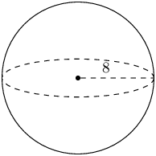

**Solution:**
\begin{align*}
                V_{\text{sphere}} & = \frac{4}{3} \pi r^{3} \\
                & = \frac{4}{3} \pi (\text{8})^{3} \\
                & = \frac{4}{3} \pi (\text{512}) \\
                & = \frac{2048}{3} \pi \\
                & = \text{2 144,6605...}
                \end{align*}

Therefore the volume for the sphere is \(\text{2 144,66}\) units3.

**Problem:**
The figure here is a cone. The vertical height of the cone is \(H = \text{7}\) units and the slant
                height is \(h = \text{7,28}\) units; the radius of the cone is shown, \(r = \text{2}\) units. Calculate
                the volume of the figure. Round your answer to two decimal places.

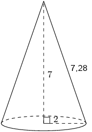

**Solution:**
\begin{align*}
              V_{\text{cone}} & = \frac{1}{3} \times \pi r^{2}H \\
              & = \frac{1}{3} \times \pi (\text{2})^{2} (\text{7}) \\
              & = \frac{1}{3} \pi (\text{4})(\text{7}) \\
              & = \frac{28}{3}\pi \\
              & = \text{29,3215...}
              \end{align*}

Therefore the volume of the cone is \(\text{29,32}\) units3.

**Problem:**
The figure here is a pyramid with a square base. The vertical height of the pyramid is \(H = \text{8}\)
                units and the slant height is \(h = \text{8,94}\) units; each side of the base of the pyramid is \(b =
                \text{8}\) units. Round your answer to two decimal places.

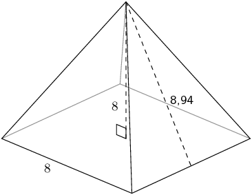

**Solution:**
\begin{align*}
              V_{\text{square pyramid}} & = \frac{1}{3} b^{2}H \\
              & = \frac{1}{3} (\text{8})^{2} (\text{8}) \\
              & = \frac{1}{3} (\text{64})(\text{8}) \\
              & = \frac{512}{3} \\
              & \approx \text{170,6666...}
              \end{align*}

Therefore the volume of the square pyramid is: \(\text{170,67}\) units3.

Find the volume of the following objects (round off to 1 decimal place if needed):

**Problem:**

**Solution:**
We are given the radius of the cone and the slant height. We can use this to find the vertical height
                  (\(H\)) of the cone:

                \begin{align*}
                H^{2} & = 13^{2} - 5^{2} \\
                & = 144 \\
                H & = 12
                \end{align*}

Now we can calculate the volume of the cone:

                \begin{align*}
                V &= \frac{1}{3} \times \pi (r)^2 \times H\\
                &= \frac{1}{3} \pi (5)^2 (12) \\
                & = 100 \pi \\
                & \approx \text{314,2}\text{ cm$^{3}$}
                \end{align*}

**Problem:**
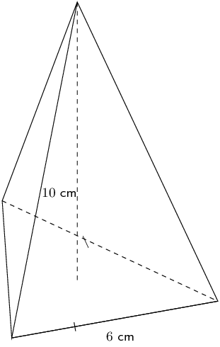

**Solution:**
We first need to find the vertical (perpendicular) height of the triangle (\(h\)) using the theorem
                  of Pythagoras:

                \begin{align*}
                h^2 &= b^2 - \left(\frac{b}{2}\right)^2 \\
                &= 36 - 9 \\
                &= 27 \\
                h &= \sqrt{27} ~\text{cm}
                \end{align*}

Now we can find the volume:

                \begin{align*}
                V &= \frac{1}{3} \times \frac{1}{2} bh \times H \\
                &= \frac{1}{3} \times \frac{1}{2}(\sqrt{27})(6) \times (10) \\
                & = 10 \sqrt{27} \\
                & \approx \text{52,0}\text{ cm$^{3}$}
                \end{align*}

**Problem:**
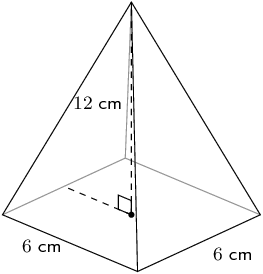

**Solution:**
\begin{align*}
                V &= \frac{1}{3} \times b^{2} \times H \\
                &= \frac{1}{3} (6)^2(12) \\
                &= \text{144}\text{ cm$^{3}$}
                \end{align*}

**Problem:**

**Solution:**
\begin{align*}
                  V & = \frac{4}{3} \pi r^{3}\\
                  & = \frac{4}{3} \pi (10)^{3}\\
                  & \approx \text{4 188,8}\text{ cm$^{3}$}
                  \end{align*}

**Problem:**
Find the surface area and volume of the cone shown here. Round your answers to the nearest integer.

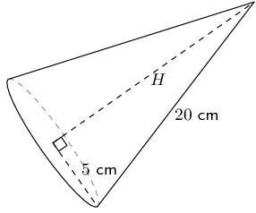

**Solution:**
The surface area of the cone is:

              \begin{align*}
              A_{\text{cone}} & = \pi r(r + h)\\
              & = \pi(5)(5 + 20)\\
              & = \text{392,69908...}\text{ cm$^{2}$} \\
              & \approx \text{393}\text{ cm$^{2}$}
              \end{align*}

For the volume we first need to find the perpendicular (or vertical) height using the theorem of
                Pythagoras:

              \begin{align*}
              H^{2} & = 20^{2} - 5^{2} \\
              H & = \sqrt{400 - 25} \\
              & = \sqrt{375}
              \end{align*}

Now we can calculate the volume of the cone:

              \begin{align*}
              V_{\text{cone}} & = \frac{1}{3}\pi r^{2} h\\
              & = \frac{1}{3}\pi (5)^{2} (\sqrt{375})\\
              & = \text{506,97233...}\text{ cm$^{3}$}\\
              & \approx \text{507}\text{ cm$^{3}$}
              \end{align*}

Therefore the surface area is \(\text{393}\) \(\text{cm$^{2}$}\) and the volume is \(\text{507}\)
                \(\text{cm$^{3}$}\).

Calculate the following properties for the pyramid shown below. Round your answers to two decimal
                places.

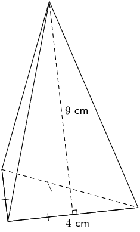

**Problem:**
Surface area

**Solution:**
We first calculate the vertical (perpendicular) height of the base triangle:

                \begin{align*}
                h_{b}^{2} & = 4^{2} - 2^{2}\\
                & = 16 - 4 \\
                h_{b} & = \sqrt{12}
                \end{align*}

Now we can calculate the surface area of the pyramid:

                \begin{align*}
                A_{\text{pyramid}} & = \frac{1}{2}b(h_{b} + 3h_{s}) \\
                & = \frac{1}{2}(6)(\sqrt{12} + 3(9))\\
                & = \text{91,39230...}\text{ cm$^{2}$}
                \end{align*}

Therefore the surface area of the triangular pyramid is: \(\text{91,39}\) \(\text{cm$^{2}$}\).

**Problem:**
Volume

**Solution:**
We first need to find the vertical height (\(H\)):

                \begin{align*}
                H^{2} & = 9^{2} - 3^{2} \\
                & = 81 - 9 \\
                H & = \sqrt{72}
                \end{align*}

Now we can find the volume:

                \begin{align*}
                V_{\text{pyramid}} &= \frac{1}{3} \times \frac{1}{2}(b)(h_{b}) \times H \\
                & = \frac{1}{6}(6)(\sqrt{12}) \times (\sqrt{72})\\
                & = \text{29,39387...}\text{ cm$^{3}$}
                \end{align*}

Therefore the volume of the pyramid is: \(\text{29,39}\) \(\text{cm$^{3}$}\).

**Problem:**
The solid below is made up of a cube and a square pyramid. Find its volume and surface area (correct to
                \(\text{1}\) decimal place):

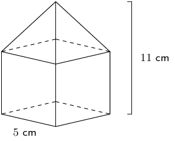

**Solution:**
The height of the cube is \(\text{5}\) \(\text{cm}\). Since the total height of the object is
                \(\text{11}\) \(\text{cm}\), the height of the pyramid must be \(\text{6}\) \(\text{cm}\).

We will work out the volume first:

              \begin{align*}
              \text{Volume} &= \text{volume of cube} + \text{volume of square pyramid}\\
              & = s^{3} + \frac{1}{3}bH \\
              & = (5)^{3} + \frac{1}{3}(5)^{2}(6)\\
              & = \text{175}\text{ cm$^{3}$}
              \end{align*}

For the surface area we note that one face of the cube is covered by the pyramid. We also note that the
                base of the pyramid is covered by the cube. So we only need to find the area of 5 sides of the cube and
                the four triangular faces of the pyramid.

For the triangular faces we need the slant height. We can calculate this using the theorem of
                Pythagoras:

              \begin{align*}
              h_{s}^{2} & = H^{2} + \left(\frac{b}{2}\right)^{2} \\
              & = (6)^{2} + (\text{2,5})^{2} \\
              h_{s} & = \sqrt{\text{42,25}}
              \end{align*}

The surface area is:

              \begin{align*}
              \text{Surface area } &= 5(\text{sides of cube}) + 4(\text{triangle faces of pyramid}) \\
              &= 5(s^{2}) + 4\left(\frac{1}{2}bh_{s}\right) \\
              & = 5(5^{2}) + 4\left(\frac{1}{2}(5)(\sqrt{\text{42,25}})\right) \\
              & = 125 + 10\sqrt{\text{42,25}} \\
              & = \text{190}\text{ cm$^{2}$}
              \end{align*}

The surface area is \(\text{190}\) \(\text{cm$^{2}$}\) and the volume is \(\text{175}\)
                \(\text{cm$^{3}$}\).
