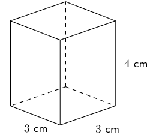
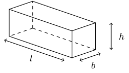
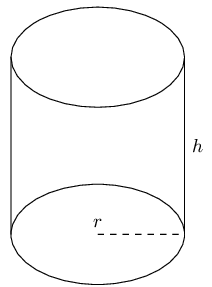
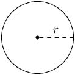
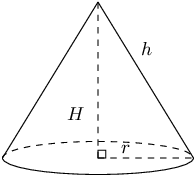
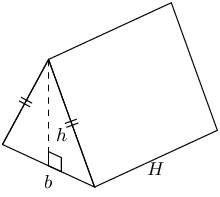

## 13.4 The effect of multiplying a dimension by a factor of k (EMA7T)

When one or more of the dimensions of a prism or cylinder is multiplied by a constant, the surface area and
      volume will change. The new surface area and volume can be calculated by using the formulae from the preceding
      section.

It is possible to see a relationship between the change in dimensions and the resulting change in surface area
      and volume. These relationships make it simpler to calculate the new volume or surface area of an object when its
      dimensions are scaled up or down.

Consider a rectangular prism of dimensions \(l\), \(b\) and \(h\). Below we multiply one, two and three of its
      dimensions by a constant factor of \(\text{5}\) and calculate the new volume and surface area.

| Dimensions | Volume | Surface |
| --- | --- | --- |
| Original dimensions | \(\begin{array}{rl} V& =l\times b\times h\\
            & =lbh
            \end{array}\) | \(\begin{array}{rl} A& =2\left[\left(l\times h\right)+\left(l\times b\right)+\left(b\times
            h\right)\right]\\
            & =2\left(lh+lb+bh\right)
            \end{array}\) |
| Multiply one dimension by \(\text{5}\) | \(\begin{array}{rl} {V}_{1}& =l\times b\times 5h\\
            & =5\left(lbh\right)\\
            & =5V
            \end{array}\) | \(\begin{array}{rl} {A}_{1}& =2\left[\left(l\times 5h\right)+\left(l\times b\right)+\left(b\times
            5h\right)\right]\\
            & =2\left(5lh+lb+5bh\right)
            \end{array}\) |
| Multiply two dimensions by \(\text{5}\) | \(\begin{array}{rl} {V}_{2}& =5l\times b\times 5h\\
            & =5.5\left(lbh\right)\\
            & ={5}^{2}\times V
            \end{array}\) | \(\begin{array}{rl} {A}_{2}& =2\left[\left(5l\times 5h\right)+\left(5l\times b\right)+\left(b\times
            5h\right)\right]\\
            & =2\times 5\left(5lh+lb+bh\right)
            \end{array}\) |
| Multiply all three dimensions by \(\text{5}\) | \(\begin{array}{rl} {V}_{3}& =5l\times 5b\times 5h\\
            & ={5}^{3}\left(lbh\right)\\
            & ={5}^{3}V
            \end{array}\) | \(\begin{array}{rl} {A}_{3}& =2\left[\left(5l\times 5h\right)+\left(5l\times 5b\right)+\left(5b\times
            5h\right)\right]\\
            & =2\left({5}^{2}lh+{5}^{2}lb+{5}^{2}bh\right)\\
            & ={5}^{2}\times 2\left(lh+lb+bh\right)\\
            & ={5}^{2}A
            \end{array}\) |
| Multiply all three dimensions by k | \(\begin{array}{rl} {V}_{k}& =kl\times kb\times kh\\ & ={k}^{3}\left(lbh\right)\\ & ={k}^{3}V
            \end{array}\) | \(\begin{array}{rl} {A}_{k}& =2\left[\left(kl\times kh\right)+\left(kl\times kb\right)+\left(kb\times
            kh\right)\right]\\ & ={k}^{2}\times 2\left(lh+lb+bh\right)\\ & ={k}^{2}A
            \end{array}\) |

<Callout type="tip" title="Worked example 18: Calculating the new dimensions of a rectangular prism">
**Question:**
Consider a rectangular prism with a height of \(\text{4}\) \(\text{cm}\) and base lengths of \(\text{3}\)
          \(\text{cm}\).

1. Calculate the surface area and volume.
2. Calculate the new surface area (\({A}_{n}\)) and volume (\({V}_{n}\)) if the base lengths are multiplied by a constant factor of \(\text{3}\).
3. Express the new surface area and volume as a factor of the original surface area and volume.

**Calculate the original volume and surface area:**
\begin{align*}
        V & =l\times b\times h \\
        & = 3 \times 3 \times 4 \\
        & = \text{36}\text{ cm$^{3}$} \\ \\
        A& = 2\left[\left(l\times h\right) + \left(l\times b\right) + \left(b\times h\right)\right] \\
        & = 2\left[\left(3\times 4\right) + \left(3\times 3\right) + \left(3\times 4\right)\right] \\
        & = \text{66}\text{ cm$^{2}$}
        \end{align*}

**Calculate the new volume and surface area:**
Two of the dimensions are multiplied by a factor of 3.

        \begin{align*}
        {V}_{n} & = 3l \times 3b\times h \\
        & = 3(3) \times 3(3) \times 4 \\
        & = \text{324}\text{ cm$^{3}$} \\ \\
        {A}_{n} & = 2\left[\left(3l \times h\right) + \left(3l \times 3b \right) + \left(3b\times h\right)\right] \\
        & = 2\left[\left(3(3) \times 4\right) + \left(3(3) \times 3(3)\right) + \left(3(3)\times 4\right)\right] \\
        & = \text{306}\text{ cm$^{2}$}
        \end{align*}

**Express the new dimensions as a factor of the original dimensions:**
\begin{align*}
        V & = 36 \\
        {V}_{n} & = 324 \\
        \frac{{V}_{n}}{V} & = \frac{324}{36} \\
        & = 9 \\
        \therefore {V}_{n} & = 9V \\
        & = {3}^{2}V \\ \\
        A& = 66 \\
        {A}_{n} & = 306 \\
        \frac{{A}_{n}}{A} & = \frac{306}{66} \\
        \therefore {A}_{n}& = \frac{306}{66}A \\
        & = \frac{51}{11}A
        \end{align*}
</Callout>

<Callout type="tip" title="Worked example 19: Multiplying the dimensions of a rectangular prism by \(k\)">
**Question:**
Prove that if the height of a rectangular prism with dimensions \(l\), \(b\) and \(h\) is multiplied by a
          constant value of \(k\), the volume will also increase by a factor \(k\).

**Calculate the original volume:**
We are given the original dimensions \(l\), \(b\) and \(h\) and so the original volume is \(V = l \times b
          \times h\).

**Calculate the new volume:**
The new dimensions are \(l\), \(b\), and \(kh\) and so the new volume is:

        \begin{align*}
        {V}_{n} & = l \times b \times \left(kh\right) \\
        & = k \left(lbh\right) \\
        & = kV
        \end{align*}

**Write the final answer:**
If the height of a rectangular prism is multiplied by a constant \(k\), then the volume also increases by a
          factor of \(k\).
</Callout>

<Callout type="tip" title="Worked example 20: Multiplying the dimensions of a cylinder by \(k\)">
**Question:**
Consider a cylinder with a radius of \(r\) and a height of \(h\). Calculate the new volume and surface area
          (expressed in terms of \(r\) and \(h\)) if the radius is multiplied by a constant factor of \(k\).

**Calculate the original volume and surface area:**
\begin{align*}
        V & = \pi {r}^{2} \times h \\
        A & = \pi {r}^{2} + 2 \pi rh
        \end{align*}

**Calculate the new volume and surface area:**
The new dimensions are \(kr\) and \(h\).

        \begin{align*}
        {V}_{n} & =\pi {\left(kr\right)}^{2}\times h \\
        & = \pi {k}^{2}{r}^{2}\times h \\
        & = {k}^{2}\times \pi {r}^{2}h \\
        & = {k}^{2}V \\ \\
        {A}_{n} & = \pi {\left(kr\right)}^{2} + 2\pi \left(kr\right)h \\
        & = \pi {k}^{2}{r}^{2} + 2\pi krh \\
        & = {k}^{2}\left(\pi {r}^{2}\right) + k\left(2\pi rh\right)
        \end{align*}
</Callout>

### Textbook Exercise 13.6

**Problem:**
If the length of the radius of a circle is a third of its original size, what will the area of the new
              circle be?

**Solution:**
The area of the original circle is: \(\pi r^{2}\). Now we reduce the radius by a third. In other words we
              multiply \(r\) by one third. The new area is:

            \begin{align*}
            A_{\text{new}} & = \pi \left(\frac{1}{3}r\right)^{2} \\
            & = \frac{1}{9} \pi r^{2} \\
            & = \frac{1}{9} A
            \end{align*}

Therefore, if the radius of a circle is a third of its original size, the area of the new circle will be
              \(\frac{1}{9}\) the original area.

**Problem:**
If the length of the base's radius and height of a cone is doubled, what will the surface area of the new
              cone be?

**Solution:**
We can find the new area by noting that the area will change by a factor of \(k\) when we change the
              dimensions of the cone. In this case we are changing two dimensions of the cone and so the new area will
              be: \(A_{\text{new}} = k^{2}A\)

The value of \(k\) comes from the word “doubled” in the question: the value of \(k\) is 2.

So the new area of the cone will be \(A_{\text{new}} = 4 \times A\) if we double the height and the
              base's radius of the cone.

Therefore the surface area of the new cone will be 4 times the original surface area.

**Problem:**
If the height of a prism is doubled, how much will its volume increase by?

**Solution:**
We do not know if we have a rectangular prism or a triangular prism. However we do know that the volume
              of a prism is given by:

            \[V = \text{area of base} \times \text{height of prism}\]

Now we are changing just one dimension of the prism: the height. Therefore the new volume is given by:

            \begin{align*}
            V_{\text{new}} & = \text{area of base} \times 2(\text{height of prism}) \\
            & = 2V
            \end{align*}

Therefore the volume of the prism doubles if the height is doubled.

Describe the change in the volume of a rectangular prism if the:

**Problem:**
length and breadth increase by a constant factor of \(\text{3}\).

**Solution:**
The volume of a rectangular prism is given by \(V = l \times b \times h\). If we increase the length
                and breadth by a constant factor of 3 the volume is:

              \begin{align*}
              V_{\text{new}} & = 3(l) \times 3(b) \times h \\
              & = 9 V
              \end{align*}

Therefore the volume of the prism increases by a factor of 9 when the length and breadth are increased
                by a constant factor of 3.

**Problem:**
length, breadth and height are multiplied by a constant factor of \(\text{3}\).

**Solution:**
The volume of a rectangular prism is given by \(V = l \times b \times h\). If we increase the length,
                breadth and height by a constant factor of 3 the volume is:

              \begin{align*}
              V_{\text{new}} & = 3(l) \times 3(b) \times 3(h) \\
              & = 27 V
              \end{align*}

Therefore the volume of the prism increases by a factor of 27 when the length, breadth and height are
                increased by a constant factor of 3.

**Problem:**
If the length of each side of a triangular prism is quadrupled, what will the volume of the new
              triangular prism be?

**Solution:**
When multiplied by a factor of \(k\) the volume of a shape will increase by \(k^{3}\). We are told that
              the dimensions are quadrupled. This means that each dimension is multiplied by 4. Therefore \(k = 4\).

Now we can calculate \(k^{3}\).

            \[k^{3} = \left( 4 \right)^3 = 64\]

Therefore, if each side of a triangular prism is quadrupled, the volume of the new triangular prism will
              be 64 times the original shape's volume.

**Problem:**
Given a prism with a volume of \(\text{493}\) \(\text{cm$^{3}$}\) and a surface area of
              \(\text{6 007}\) \(\text{cm$^{2}$}\), find the new surface area and volume for a prism if all
              dimensions are increased by a constant factor of \(\text{4}\).

**Solution:**
We are increasing all the dimensions by 4 and so the volume will increase by \(4^{3}\). The surface area
              will increase by \(4^{2}\).

            \begin{align*}
            V &= 493 \times 4^{3} \\
            & = \text{31 552}\text{ cm$^{3}$} \\
            \text{Surface area} &= \text{6 007} \times 4^{2} \\
            &= \text{96 112}\text{ cm$^{2}$}
            \end{align*}

Therefore the volume is \(\text{31 552}\) \(\text{cm$^{3}$}\) and the surface area is
              \(\text{96 112}\) \(\text{cm$^{2}$}\).
