### Textbook Exercise 13.7

Find the area of each of the shapes shown. Round your answer to two decimal places if necessary.

**Problem:**
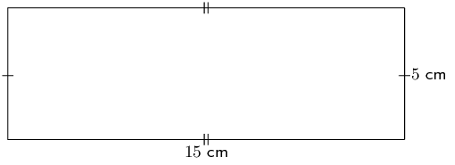

**Solution:**
\begin{align*}
              A_{\text{rectangle}} & = l \times b\\
              & = (15)(5)\\
              & = \text{75}\text{ cm$^{2}$}
              \end{align*}

**Problem:**
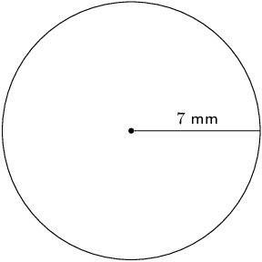

**Solution:**
\begin{align*}
              A_{\text{circle}} & = \pi r^{2}\\
              & = (3,1415...)(\text{7})^{2} \\
              & = \text{153,93804...} \\
              & \approx \text{153,94}\text{ mm$^{2}$}
              \end{align*}

**Problem:**
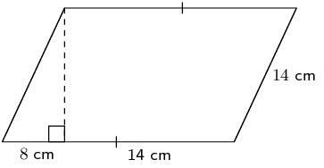

**Solution:**
We first need to find the height:

            \begin{align*}
            h^{2} & = (14)^{2} - (8)^{2}\\
            h & = \sqrt{132}
            \end{align*}

Now we can find the area of the parallelogram. Note that the length of the base is \(b = 8 + 14 = 22\).

            \begin{align*}
            A_{\text{parallelogram}} & = b \times h\\
            & = (22)(\sqrt{132})\\
            & \approx \text{252,76}\text{ cm$^{2}$}
            \end{align*}

**Problem:**
Find an expression for the area of this figure in terms of \(y\). The dimensions of the figure are
              labelled \(-5y\) and \(-3y + 2\). Write your answer in expanded form (not factorised).

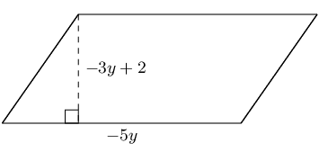

**Solution:**
\begin{align*}
            A & = bh \\
            A & = (-5y)(-3y + 2) \\
            A & = 15y^{2} - 10y
            \end{align*}

**Problem:**
Find an expression for the area of this figure in terms of \(y\). The figure has dimensions of \(-5y\)
              and \(-3y + 2\), as labelled. Write your answer in expanded form (not factorised).

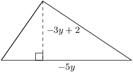

**Solution:**
\begin{align*}
            A & = \frac{1}{2}bh \\
            A & = \frac{1}{2}(-5y)(-3y + 2) \\
            A & = \frac{15y^{2}}{2} - 5y
            \end{align*}

**Problem:**
The figure here is a triangular prism. The height of the prism is \(\text{12}\) units; the triangles, which
            are both right triangles, have sides which are \(\text{5}\), \(\text{12}\) and \(\text{13}\) units long.
            Find the surface area of the figure.

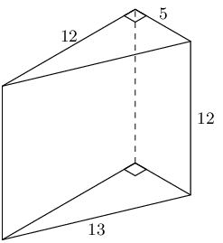

**Solution:**
A triangular prism is made up of 2 triangles and 3 rectangles. In this case the triangles are right-angled
            triangles and so we have the height of the triangle. We also note that each rectangle has a different length
            and breadth.

          \begin{align*}
          A_{\triangle \text{ prism}} & = 2A_{\text{triangles}} + 3A_{\text{rectangles}} \\
          & = 2 \left[\frac{1}{2}b_{\triangle}h_{\triangle} \right] + b_{1}h_{1} + b_{2}h_{2} + b_{3}h_{3} \\
          & = 2 \left[\frac{1}{2}(\text{5})(\text{12}) \right] + (\text{12})(\text{12}) + (\text{5})(\text{12}) +
          (\text{13})(\text{12}) \\
          & = \text{60} + \text{144} + \text{60} + \text{156} \\
          & = \text{420}
          \end{align*}

**Problem:**
The figure here is a rectangular prism. The height of the prism is \(\text{5}\) units; the other dimensions
            of the prism are \(\text{8}\) and \(\text{5}\) units. Find the surface area of the figure.

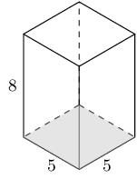

**Solution:**
A rectangular prism is made up of 6 rectangles. In this case there are 4 rectangles with a breadth of 5
            units and a height of 8 units and two rectangles with a breadth of 5 units and a height of 5 units.

          \begin{align*}
          A_{\text{rectangular prism}} & = A_{\text{6 rectangles}} \\
          & = 4(b_{1}h_{1}) + 2(b_{2}h_{2}) \\
          & = 4(8)(5) + 2(5)(5) \\
          & = 4(40) + 2(25) \\
          & = \text{210}
          \end{align*}

**Problem:**
A cylinder is shown below. The height of the cylinder is \(\text{11}\) \(\text{cm}\); the radius of the
            cylinder is \(r = \text{6}\text{ cm}\), as shown. Find the surface area of the figure. Round your answer to
            two decimal places.

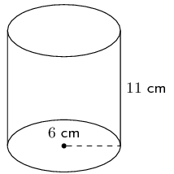

**Solution:**
A cylinder is made up of two circles and a rectangle. We can find the area of each of these and add them up
            to find the surface area of the cylinder. For the rectangle we note that the length is the circumference of
            the circle.

          \begin{align*}
          A_{\text{cylinder}} & = A_{\text{2 circles}} + A_{\text{1 rectangle}} \\
          & = 2 (\pi r^{2}) + b(2\pi r) \\
          & = 2 \left(\pi (6)^{2}\right) + (11)(2\pi (6)) \\
          & = 2 \left(36 \pi \right) + 132\pi \\
          & = 204 \pi \\
          & \approx \text{640,88}
          \end{align*}

**Problem:**
The figure here is a triangular prism. The height of the prism is \(\text{12}\) units; the triangles, which
            both contain right angles, have sides which are \(\text{5}\), \(\text{12}\) and \(\text{13}\) units long.
            Determine the volume of the figure.

**Solution:**
\begin{align*}
          V_{\triangle \text{prism}} & = \text{area of base} \times \text{height} \\
          & = \left[\frac{1}{2}b_{\triangle}h_{\triangle} \right] (H) \\
          & = \left[\frac{1}{2}(5)(12) \right](12) \\
          & = (30)(12) \\
          & = 360
          \end{align*}

**Problem:**
The figure here is a rectangular prism. The height of the prism is \(\text{5}\) units; the other dimensions
            of the prism are \(\text{12}\) and \(\text{5}\) units. Calculate the volume of the figure.

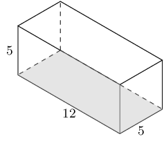

**Solution:**
\begin{align*}
          V_{\text{rectangular prism}} & = \text{area of base} \times \text{height} \\
          & = (bh)(H) \\
          & = (\text{5} \times \text{12})(\text{5}) \\
          & = \text{300}
          \end{align*}

**Problem:**
The picture below shows a cylinder. The height of the cylinder is \(\text{12}\) \(\text{cm}\); the radius
            of the cylinder is \(r = \text{7}\text{ cm}\). Calculate the volume of the figure. Round your answer two
            decimal places.

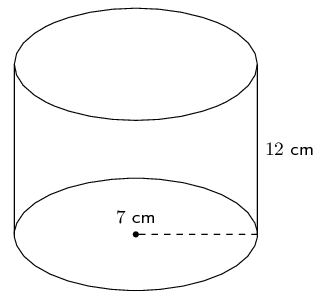

**Solution:**
\begin{align*}
          V_{\text{cylinder}} & = (\text{area of circle})(H) \\
          & = \left[\pi r^{2}\right](H) \\
          & = \left[\pi (\text{7})^{2}\right](\text{12}) \\
          & = \left[\pi \text{49}\right](\text{12}) \\
          & \approx \text{1 847,26}
          \end{align*}

**Problem:**
The figure here is a sphere. The radius of the sphere is \(r = \text{7}\) units. Find the surface area of
            the figure. Round your answer two decimal places.

**Solution:**
\begin{align*}
          A_{\text{sphere}} & = 4\pi r^{2} \\
          & = 4\pi (\text{7})^{2} \\
          & = 4\pi (\text{49}) \\
          & = 196 \pi \\
          & \approx \text{615,75}
          \end{align*}

**Problem:**
The figure here shows a pyramid with a square base. The sides of the base are each \(\text{4}\) units long.
            The vertical height of the pyramid is \(\text{8,77}\) units, and the slant height of the pyramid is
            \(\text{9}\) units. Determine the surface area of the pyramid.

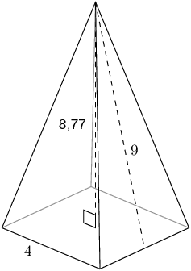

**Solution:**
\begin{align*}
          A_{\text{square pyramid}} & = A_{\text{1 square}} + A_{\text{4 triangles}} \\
          & = (b)^{2} + 4 \left(\frac{1}{2} bh_{s} \right) \\
          & = (\text{4})^{2} + 4\left(\frac{1}{2}( \text{4}) (\text{9})\right) \\
          & = \text{16} + 2(\text{36}) \\
          & = \text{88}
          \end{align*}

The total surface area for the pyramid is: \(\text{88}\) square units.

**Problem:**
The figure here is a cone. The vertical height of the cone is \(H = \text{7,41}\) units and the slant
            height of the cone is \(h = \text{8}\) units; the radius of the cone is shown, \(r = \text{3}\) units. Find
            the surface area of the figure. Round your answer two decimal places.

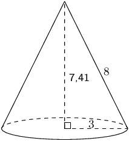

**Solution:**
\begin{align*}
          A_{\text{cone}} & = \pi r (r + h) \\
          & = \pi (\text{3})(\text{3} + \text{8}) \\
          & = 33 \pi \\
          & = \text{103,6725...}
          \end{align*}

Therefore the total surface area for the cone is \(\text{103,67}\) square units.

**Problem:**
The figure below shows a sphere. The radius of the sphere is \(r = \text{3}\) units. Determine the volume
            of the figure. Round your answer to two decimal places.

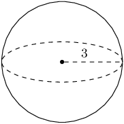

**Solution:**
\begin{align*}
          V_{\text{sphere}} & = \frac{4}{3} \pi r^{3} \\
          & = \frac{4}{3} \pi (\text{3})^{3} \\
          & = \frac{4}{3} \pi (\text{27}) \\
          & = 36 \pi \\
          & = \text{113,0973...}
          \end{align*}

Therefore the volume for the sphere is \(\text{113,1}\) units3.

**Problem:**
The figure here is a cone. The vertical height of the cone is \(H = \text{7}\) units and the slant height
            is \(h = \text{8,60}\) units; the radius of the cone is shown, \(r = \text{5}\) units. Find the volume of
            the figure. Round your answer to two decimal places.

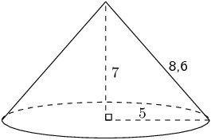

**Solution:**
\begin{align*}
          V_{\text{cone}} & = \frac{1}{3} \times \pi r^{2}H \\
          & = \frac{1}{3} \times \pi (\text{5})^{2} (\text{7}) \\
          & = \frac{1}{3} \pi (\text{25})(\text{7}) \\
          & = \frac{175}{3}\pi \\
          & = \text{183,2595...}
          \end{align*}

Therefore the volume is \(\text{183,26}\) units3.

**Problem:**
The figure here is a pyramid with a square base. The vertical height of the pyramid is \(H = \text{8}\)
            units and the slant height is \(h = \text{8,73}\) units; each side of the base of the pyramid is \(b =
            \text{7}\) units. Find the volume of the figure. Round your answer to two decimal places.

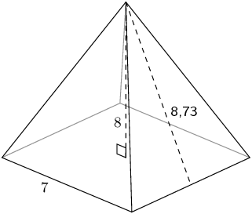

**Solution:**
\begin{align*}
          V_{\text{square pyramid}} & = \frac{1}{3} b^{2}H \\
          & = \frac{1}{3} (\text{7})^{2} (\text{8}) \\
          & = \frac{1}{3} (\text{49})(\text{8}) \\
          & = \frac{392}{3}
          \end{align*}

Therefore the volume is: \(\text{130,67}\) units cubed

Consider the solids below:

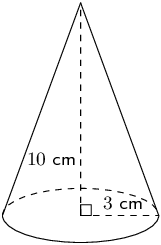

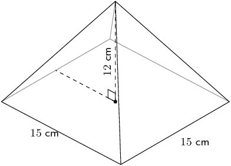

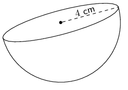

**Problem:**
Calculate the surface area of each solid.

**Solution:**
Cone

We first need to calculate the slant height:

            \begin{align*}
            h_{s}^{2} & = r^{2} + h^{2} \\
            & = 3^{2} + 10^{2} \\
            h_{s} & = \sqrt{109}
            \end{align*}

Now we can calculate the surface area:

            \begin{align*}
            \text{Surface area} &= \pi r (r + h_{s}) \\
            & = \pi (3)(3 + \sqrt{109})\\
            & \approx \text{126,67}\text{ cm$^{2}$}
            \end{align*}

Square pyramid

We first need to calculate the slant height:

            \begin{align*}
            h_{s}^{2} & = b^{2} + h^{2} \\
            & = (\text{7,5})^{2} + 12^{2} \\
            h_{s} & = \sqrt{\text{200,25}}
            \end{align*}

Now we can calculate the surface area:

            \begin{align*}
            \text{Surface area} &= b(b + 2h_{s})\\
            & = (\text{15})(\text{15} + 2\sqrt{\text{200,25}}) \\
            & \approx \text{437,26}\text{ cm$^{2}$}
            \end{align*}

Half sphere

For a half sphere we need to divide the surface area of a sphere by 2. We also need to include the area
              of a circle.

            \begin{align*}
            \text{Surface area} &= \frac{4 \pi r^2}{2} + \pi r^{2}\\
            & = 2 \pi (4)^{2} + \pi (4)^{2} \\
            & = 48 \pi \\
            & \approx \text{150,80}\text{ cm$^{2}$}
            \end{align*}

The surface area of each of the objects is:

- \(A_{\text{cone}} = \text{126,67}\text{ cm$^{2}$}\)
- \(A_{\text{square pyramid}} = \text{437,26}\text{ cm$^{2}$}\)
- \(A_{\text{half sphere}} = \text{150,80}\text{cm$^{2}$}\)>

**Problem:**
Calculate the volume of each solid.

**Solution:**
Cone

            \begin{align*}
            V &= \frac{1}{3} \pi r^{2} H \\
            & = \frac{1}{3} \pi (3)^2 \times 10 \\
            & = 30 \pi \\
            & \approx \text{94,25}\text{ cm$^{3}$}
            \end{align*}

Square pyramid:

            \begin{align*}
            V & = \frac{1}{3} b^{2} \times H \\
            & = \frac{1}{3} (15)^2 \times 12 \\
            & = \text{900}\text{ cm$^{3}$}
            \end{align*}

Half sphere

The volume of a half sphere is half the volume of a sphere.

            \begin{align*}
            V & = \frac{4}{3}\pi r^{3} \times \frac{1}{2}\\
            & = \frac{4}{3} \pi (4)^{3} \times \frac{1}{2} \\
            & = 18 \pi\\
            & \approx \text{134,04}\text{ cm$^{3}$}
            \end{align*}

The volume of each of the objects is:

- \(V_{\text{cone}} = \text{94,25}\text{ cm$^{3}$}\)
- \(V_{\text{square pyramid}} = \text{900}\text{ cm$^{3}$}\)
- \(V_{\text{half sphere}}= \text{134,04}\text{ cm$^{3}$}\)

**Problem:**
If the length of each side of a square is a quarter of its original size, what will the area of the new
            square be?

**Solution:**
When we multiply the sides of a square by a factor of \(k\) the area of the square will increase by
            \(k^{2}\).

In this case we are making each side of the square a quarter of the original size so we get:

          \begin{align*}
          A_{\text{new}} & = \left(\frac{1}{4}s\right)^{2} \\
          & = \frac{1}{16}s^{2} \\
          & = \frac{1}{16}A
          \end{align*}

Therefore, if each side of a square is a quarter of its original size, the area of the new square will be
            \(\frac{1}{16}\) times the original square's area.

**Problem:**
If the length of each side of a square pyramid is a third of its original size, what will the surface area
            of the new square pyramid be?

**Solution:**
When we multiply two dimensions of a square pyramid by a factor of \(k\) the area of the square pyramid
            will change by \(k^{2}\).

In this case the length each side of the square pyramid is a third of the original size so we get:

          \begin{align*}
          A_{\text{new}} & = \frac{1}{3}\left(\frac{1}{3}b\right)^{2}H \\
          & = \frac{1}{9}\left( \frac{1}{3}b^{2}H\right) \\
          & = \frac{1}{9}A
          \end{align*}

Therefore, if each side of a square pyramid is a third of its original size, the surface area of the new
            square pyramid will be \(\frac{1}{9}\) times the original shape's surface area.

**Problem:**
If the length of the base's radius and the height of a cylinder is halved, what will the volume of the new
            cylinder be?

**Solution:**
In this case the base's radius and the height of a cylinder is half of the original size so we get:

          \begin{align*}
          A_{\text{new}} & = \frac{1}{3}\pi \left(\frac{1}{2}r\right)^{2} \left(\frac{1}{2}H\right) \\
          & = \frac{1}{8} \left(\frac{1}{3}\pi r^{2} H\right) \\
          & = \frac{1}{8}A
          \end{align*}

Therefore, if the base's radius and the height of a cylinder is halved, the volume of the new cylinder will
            be \(\frac{1}{8}\) times the original shape's volume.

Consider the solids below and answer the questions that follow (correct to \(\text{1}\) decimal place, if
            necessary):

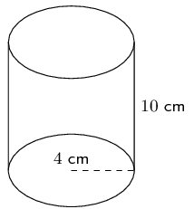

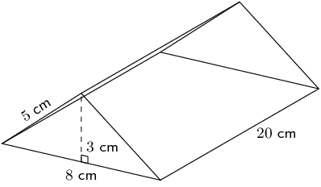

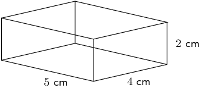

**Problem:**
Calculate the surface area of each solid.

**Solution:**
Cylinder

A cylinder is composed of two circles and a rectangle. The breadth of the rectangle is the circumference
              of the circle.

            \begin{align*}
            \text{Surface area} & = 2 \pi r^2 + 2 \pi r h \\
            & = 2 \pi (4)^2 + 2 \pi(4)(10) \\
            & = 112 \pi \\
            & \approx \text{351,9}\text{ cm$^{2}$}
            \end{align*}

Triangular prism

A triangular prism is composed of three rectangles and two triangles. We are given the vertical height of
              the triangles as well as the slant height.

            \begin{align*}
            \text{Surface area} &= 2(\frac{1}{2}b \times h) + 2(H \times h_{s}) + (H \times b)\\
            &= 2(\frac{1}{2}(8)(3)) + 2(20 \times 5) + (20 \times 8)\\
            &= \text{384}\text{ cm$^{2}$}
            \end{align*}

Rectangular prism

A rectangular prism is composed of 6 rectangles. We have the dimensions of all the rectangles.

            \begin{align*}
            \text{Surface area} &= 2[(L \times b) + (b \times h) + (L \times h)] \\
            &= 2[(5 \times 4) + (4 \times 2) + (5 \times 2)] \\
            &= \text{76}\text{ cm$^{2}$}
            \end{align*}

The surface area of each shape is:

- \(A_{\text{cylinder}} = \text{351,9}\text{ cm$^{2}$}\)
- \(A_{\text{triangular prism}} = \text{384}\text{cm$^{2}$}\)
- \(A_{\text{rectangular prism}}= \text{76}\text{ cm$^{2}$}\)

**Problem:**
Calculate volume of each solid.

**Solution:**
Cylinder

            \begin{align*}
            V & = \pi r^2 h \\
            & = \pi (4)^2(10) \\
            & = 160 \pi \\
            & = \text{502,7}\text{ cm$^{3}$}
            \end{align*}

Triangular prism

            \begin{align*}
            V &= \frac{1}{2} \times h \times b \times H\\
            &= \frac{1}{2}(3)(8)(20)\\
            &= \text{240}\text{ cm$^{3}$}
            \end{align*}

Rectangular prism

            \begin{align*}
            \text{Volume} &= l \times b \times h\\
            &= 5 \times 4 \times 2 \\
            &= \text{40}\text{ cm$^{3}$}
            \end{align*}

The volume of each shape is:

- \(V_{\text{cylinder}} = \text{502,7}\text{ cm$^{3}$}\)
- \(V_{\text{triangular prism}} = \text{240}\text{ cm$^{3}$}\)
- \(V_{\text{rectangular prism}} = \text{40}\text{ cm$^{3}$}\)

**Problem:**
If each dimension of the solids is increased by a factor of \(\text{3}\), calculate the new surface area
            of each solid.

**Solution:**
Cylinder

          \begin{align*}
          \text{Surface area} &= 2 \pi (3r)^2 + 2 \pi (3r)(3h) \\
          & = 2 \pi 9(4)^2 + 2 \pi(9)(4)(10) \\
          & = \text{1 008} \pi \\
          & \approx \text{3 166,7}\text{ cm$^{2}$}
          \end{align*}

Triangular prism

          \begin{align*}
          \text{Surface area} &= 2(\frac{1}{2}b \times h) + 2(H \times S) + (H \times b)\\
          & = 2(\frac{9}{2}(8)(3)) + 18(20 \times 5 ) + 9(20 \times 8)\\
          & = \text{3 456}\text{ cm$^{2}$}\text{3 456}
          \end{align*}

Rectangular prism

          \begin{align*}
          \text{ Surface area} &= 2[9(L \times b) + 9(b \times h) + 9(L \times h)] \\
          &= 2[9(5 \times 4) + 9(4 \times 2) + 9(5 \times 2)] \\
          &= \text{684}\text{ cm$^{2}$}
          \end{align*}

The new surface area of each shape is:

- \(A_{\text{cylinder}} = \text{3 166,7}\text{ cm$^{2}$}\)
- \(A_{\text{triangular prism}} = \text{3 456}\text{ cm$^{2}$}\)
- \(A_{\text{rectangular prism}} = \text{684}\text{ cm$^{2}$}\)

**Problem:**
If each dimension of the solids is increased by a factor of \(\text{3}\), calculate the new volume of
            each solid.

**Solution:**
Cylinder

          \begin{align*}
          V &= \pi (3r)^2 3h \\
          & = \pi (3(4))^2(3(10)) \\
          & = \text{4 320} \pi \\
          & \approx \text{13 571,9}\text{ cm$^{3}$}
          \end{align*}

Triangular prism

          \begin{align*}
          V &= \frac{1}{2} \times h \times b \times H\\
          &= \frac{27}{2}(3)(8)(20)\\
          &= \text{6 480}\text{ cm$^{3}$}
          \end{align*}

Rectangular prism

          \begin{align*}
          V &= 27(L \times b \times h)\\
          &= 27(5 \times 4 \times 2) \\
          &= \text{1 080}\text{ cm$^{3}$}
          \end{align*}

The new volume of each shape is:

- \(V_{\text{cylinder}} = \text{13 571,9}\text{ cm$^{3}$}\)
- \(V_{\text{triangular prism}} = \text{6 480}\text{ cm$^{3}$}\)
- \(V_{\text{rectangular prism}} = \text{1 080}\text{ cm$^{3}$}\)

The solid below is made of a cube and a square pyramid. Answer the following:

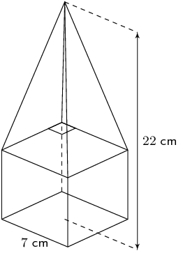

**Problem:**
Find the surface area of the solid shown. Give your answers to two decimal places.

**Solution:**
Start with the faces of the cube, which are all squares:

            \begin{align*}
            A_{\text{five squares}} & = 5 \times s^{2}\\
            & = 5 \times (\text{7})^{2}\\
            & = \text{245}\text{ cm$^{2}$}
            \end{align*}

Next we note that the height of the pyramid is:

            \[h_{\text{pyramid}} = \text{22} - \text{7} = \text{15}\]

And we need to calculate the slant height using the theorem of Pythagoras:

            \begin{align*}
            h_{s} & = \sqrt{(\text{15})^{2} + \left(\frac{1}{2}(\text{7})\right)^{2}} \\
            & = \sqrt{\left(\text{225} + \text{12,25}\right) } \\
            & = \sqrt{\text{237,25}}
            \end{align*}

Now we can calculate the area of each of the four triangles:

            \begin{align*}
            A_{\text{four triangles}} & = 4 \times \frac{1}{2}bh_{s}\\
            & = 4 \times \frac{1}{2}(\text{7})(\sqrt{\text{237,25}})\\
            & = 14\sqrt{\text{237,25}}
            \end{align*}

Finally we can calculate the total surface area:

            \begin{align*}
            A_{\text{total}} & = A_{\text{triangles}} + A_{\text{squares}} \\
            & = 14\sqrt{\text{237,25}} + \text{245}\\
            & = \text{460,6409...}\text{ cm$^{2}$} \\
            & \approx \text{460,64}\text{ cm$^{2}$}
            \end{align*}

Therefore the surface area is: \(\text{460,64}\) \(\text{cm$^{2}$}\).

**Problem:**
Now determine the volume of the shape. Give your answer to the nearest integer value.

**Solution:**
Volume of the pyramid:

            \begin{align*}
            V_{\text{pyramid}} & = \frac{1}{3}b^{2}H\\
            & = \frac{1}{3}(\text{7})^{2}(\text{15})\\
            & = \text{245}\text{ cm$^{3}$}
            \end{align*}

Volume of the cube:

            \begin{align*}
            V_{\text{cube}} & = l^{3}\\
            & = (\text{7})^{3}\\
            & = \text{343}\text{ cm$^{3}$}
            \end{align*}

Total volume:

            \begin{align*}
            V_{\text{total}} & = V_{\text{cube}} + V_{\text{pyramid}}\\
            & = \text{343} + \text{245}\\
            & = \text{588}\text{ cm$^{3}$}
            \end{align*}

Therefore the total volume is: \(\text{588}\) \(\text{cm$^{3}$}\).

**Problem:**
Calculate the volume and surface area of the solid below (correct to 1 decimal place):

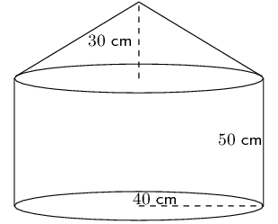

**Solution:**
Surface area

Cylinder:

          \begin{align*}
          \text{Surface area} &= \pi r^2 + 2\pi rh\\
          &= \pi(40)^2 + 2\pi(40)(50)\\
          &= \text{17 592,91}\text{ cm$^{2}$}
          \end{align*}

Cone:

          \begin{align*}
          \text{Surface area} &= 2 \pi r \sqrt{r^2 + h^2}\\
          &= 2 \pi (40) \sqrt{40^2 + 30^2} \\
          &= \text{12 566,4}\text{ cm$^{2}$}
          \end{align*}

Total surface area: \(\text{17 592,92} + \text{12 566,4} = \text{30 159,52}\text{
            cm$^{2}$}\).

Volume

Cylinder:

          \begin{align*}
          V &= \pi r^2 h\\
          &= \pi(40)^2 (50)\\
          &= \text{251 327,4}\text{ cm$^{3}$}
          \end{align*}

Cone:

          \begin{align*}
          V &= \frac{1}{3} \pi r^2 h\\
          &= \frac{1}{3} \pi (40)^2 (30) \\
          &= \text{50 265,48}\text{ cm$^{3}$}
          \end{align*}

Total volume \(= \text{251 327,4} + \text{50 265,48} = \text{301 592,88}\text{ cm$^{3}$}\).

The total surface area and volume is \(\text{30 159,52}\) \(\text{cm$^{2}$}\) and
            \(\text{301 592,88}\) \(\text{cm$^{3}$}\) respectively.

Find the volume and surface areas of the following composite shapes.

**Problem:**
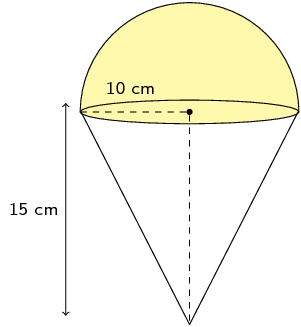

**Solution:**
The shape is a half sphere on top of a right cone. We can calculate the volume of a cone and add this to
              half the volume of a sphere. The volume is:

            \begin{align*}
            V & = \frac{1}{3}\pi r^{2}h + \frac{1}{2}\left(\frac{4}{3} \pi r^{3}\right) \\
            & = \frac{1}{3} \pi (10)^{2}(15) + \frac{2}{3} \pi (10)^{3} \\
            & = \frac{\text{3 500}}{\text{3}}\pi \\
            & = \text{3 665,19}\text{ cm$^{3}$}
            \end{align*}

For the surface area we first need to find the slant height:

            \begin{align*}
            h_{s}^{2} & = 10^{2} + 15^{2} \\
            & = 325 \\
            h_{s} & = 5\sqrt{13}
            \end{align*}

We have a half sphere on top of a cone. The half sphere covers the circle on top of the cone and so we
              need to exclude this part from our calculation. For the half sphere we can use half the surface area of a
              sphere as this does not include the circle at the base of the half sphere.

The surface area is:

            \begin{align*}
            \text{surface area } & = \pi r h_{s} + 2\pi r^{2} \\
            & = \pi \left(10\right)\left(5 \sqrt{13}\right) + 2\pi\left(10\right)^{2} \\
            & \approx \text{1 194,68}\text{ cm$^{2}$}
            \end{align*}

Therefore the volume and surface area are \(\text{3 665,19}\) \(\text{cm$^{3}$}\) and
              \(\text{1 194,67}\) \(\text{cm$^{2}$}\) respectively.

**Problem:**
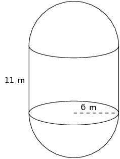

**Solution:**
We have a cylinder with two half spheres. We can calculate the volume of a cylinder and add the volume of
              a sphere to this. The volume is:

            \begin{align*}
            V & = \pi r^{2}h + \frac{4}{3} \pi r^{3} \\
            & = \pi (6)^{2}(11) + \frac{4}{3} \pi (6)^{3} \\
            & = \text{684} \pi \\
            & = \text{2 148,85}\text{ m$^{3}$}
            \end{align*}

For the surface area of the two half spheres we can use the surface area of a sphere. For the cylinder we
              need to exclude the area of the two circles from our calculation since these are covered up by the two
              half spheres. The surface area is:

            \begin{align*}
            \text{surface area } & = 2\pi rh + 4\pi r^{2} \\
            & = 2\pi \left(6\right)\left(11\right) + 4\pi\left(6\right)^{2} \\
            & = \text{276} \pi \\
            & \approx \text{867,08}\text{ m$^{2}$}
            \end{align*}

Therefore the volume and surface area are: \(\text{2 148,85}\) \(\text{m$^{3}$}\) and
              \(\text{867,08}\) \(\text{m$^{2}$}\) respectively.

**Problem:**
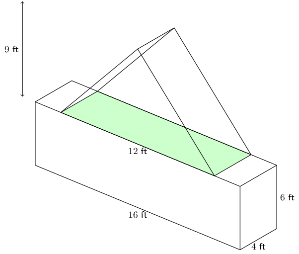

**Solution:**
This shape consists of a triangular prism and a rectangular prism. The volume is:

            \begin{align*}
            V & = \frac{1}{2}bhH + lbh \\
            & = \frac{1}{2}(12)(9)(4) + (4)(6)(16) \\
            & = \text{600}\text{ ft$^{3}$}
            \end{align*}

For the surface area we need to exclude the base of the triangular prism as well as part of the top of
              the rectangular prism.

We first need to calculate the slant height for the triangular prism:

            \begin{align*}
            h_{s}^{2} & = 9^{2} + 4^{2} \\
            & = 97 \\
            h_{s} & = \sqrt{97}
            \end{align*}

Now we can calculate the surface area of the triangular prism. Remember that we do not need to include
              the base in our calculation so we only have 2 triangles and 2 rectangles.

            \begin{align*}
            \text{surface area } & = 2\left(\frac{1}{2}bH\right) + 2\left(bh_{s}\right) \\
            & = (12)(9) + 2(12)(\sqrt{97}) \\
            & = 108 + 24\sqrt{97}
            \end{align*}

For the rectangular prism we can calculate the full surface area and then subtract the base of triangular
              prism from this.

            \begin{align*}
            \text{surface area } & = 2(bh) + 2(bl) + 2(hl) - \text{base triangular prism} \\
            & = 2(16)(6) + 2(16)(4) + 2(6)(4) - (12)(4) \\
            & = 256
            \end{align*}

Now we can add the two surface areas together to get the total surface area:

            \begin{align*}
            \text{surface area } & = 256 + (108 + 24\sqrt{97}) \\
            & \approx \text{600,37}\text{ ft$^{2}$}
            \end{align*}

The volume and surface area are \(\text{600}\) \(\text{ft$^{3}$}\) and \(\text{600,37}\)
              \(\text{ft$^{2}$}\) respectively.

**Problem:**
An ice-cream cone (right cone) has a radius of \(\text{3}\) \(\text{cm}\) and a height of \(\text{12}\)
            \(\text{cm}\). A half scoop of ice-cream (hemisphere) is placed on top of the cone. If the ice-cream melts,
            will it fit into the cone? Show all your working.

**Solution:**
We can draw a quick sketch of the problem:

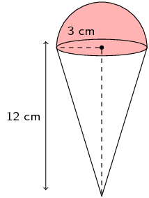

Now we can calculate the volume of the cone and the volume of the ice-cream. The scoop of ice-cream is a
            half sphere and so the volume of this is half the volume of a sphere.

          \begin{align*}
          V_{\text{cone}} & = \frac{\pi(3)^{3}12}{3} \\
          & = 36 \pi \\
          & \approx \text{113,1} \\
          V_{\text{scoop}} & = \frac{4}{6} \times \pi (3)^{3} \\
          & = 18 \pi \\
          & \approx \text{56,5}
          \end{align*}

Yes, the ice-cream will fit into the cone if it melts since the volume of the ice-cream is less than the
            volume of the cone.

A receptacle filled with petrol has the shape of an inverted right circular cone of height \(\text{120}\)
            \(\text{cm}\) and base radius of \(\text{60}\) \(\text{cm}\). A certain amount of fuel is siphoned out of
            the receptacle leaving a depth of \(h\) cm.

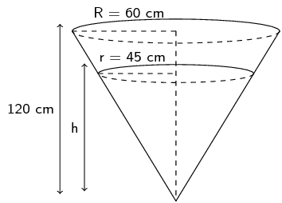

**Problem:**
Show that \(h = \text{90}\text{ cm}\).

**Solution:**
We can draw the following two triangles based on the information in the figure:

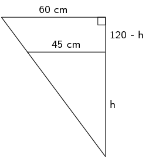

These two triangles are similar triangles. They are both right-angled and share a common angle.

Therefore we can use the ratio of the sides to find \(h\):

            \begin{align*}
            \frac{h}{120} & = \frac{45}{60} \quad \text{(similar triangles)} \\
            \therefore h & = \frac{(45)(120)}{60} \\
            & = \text{90}\text{ cm}
            \end{align*}

**Problem:**
Determine the volume of fuel that has been siphoned out. Express your answer in litres if
              \(\text{1}\text{ l} = \text{1 000}\text{ cm$^{3}$}\)

**Solution:**
The volume of fuel that has been siphoned out is the total volume of fuel minus the volume of fuel left.
              The volume of a cone is \(\frac{4}{3}\pi r^{2}H\). From the previous question we have the vertical height
              for both cones.

            \begin{align*}
            \text{Volume siphoned out } & = \frac{1}{3}\pi R^{2}H_{\text{start}} - \frac{1}{3}\pi
            r^{2}H_{\text{end}} \\
            & = \frac{1}{3}\pi (60)^{2}(120) - \frac{1}{3}\pi (45)^{2}(90) \\
            & = \text{144 000} \pi - \text{60 750} \pi \\
            & \approx \text{261 537,59}\text{ cm$^{3}$} \\
            & \approx \text{261,5}\text{ l}
            \end{align*}

Find the volume and surface area of the following prisms.

**Problem:**
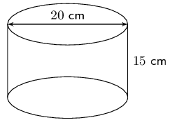

**Solution:**
We are given the diameter of the cylinder. The radius is half the diameter.

            \begin{align*}
            V & = \pi r^2 h \\
            & = \pi (10)^2(15) \\
            & = \text{15 000} \pi \\
            & \approx \text{47 123,89}\text{ cm$^{3}$}
            \end{align*}
            \begin{align*}
            A & = 2 \pi r h + 2 (\pi r^2) \\
            & = 2 (\pi (10)(15)) + 2(\pi (10)^{2}) \\
            & = 300\pi + 200 \pi \\
            & \approx \text{1 570,80}\text{ cm$^{2}$}
            \end{align*}

Therefore the volume and surface area are \(\text{47 123,89}\) \(\text{cm$^{3}$}\) and
              \(\text{1 570,80}\) \(\text{cm$^{2}$}\) respectively.

**Problem:**
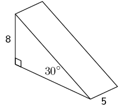

**Solution:**
This is a triangular pyramid. We are given the vertical height as well as an angle. Since it is a
              right-angled triangle we can use trigonometry to help us find the missing length.

We redraw the triangle we are interested in:

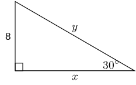

Now we can calculate \(x\) (the slant height) and \(y\) (the base):

            \begin{align*}
            \frac{x}{8} & = \tan 30° \\
            x & = 8 \tan 30° \\\\
            \frac{8}{y} & = \sin 30° \\
            \frac{8}{\sin 30°} & = y
            \end{align*}

Now we know all the lengths we need to know to calculate the volume.

            \begin{align*}
            V & = (\frac{1}{2} bh ) \times H \\
            & = (\frac{1}{2} (8)(8\tan{30^{\circ}}) ) \times 5\\
            & = 160 \tan 30^{\circ} \\
            & \approx \text{92,38}
            \end{align*}

And the surface area is:

            \begin{align*}
            A &= 2(\frac{1}{2} bh )+ (H \times h_s) + (H \times h_s) + (H \times b) + (H \times h) \\ \\
            & = 2(\frac{1}{2} (8)(8\tan{30^{\circ}}) + (5 \times \frac{8}{\sin{30^{\circ}}}) \\
            & + (5 \times 8\tan{30^{\circ}}) + (5 \times 8) \\
            & = 64 \tan{30^{\circ}} + \frac{40}{\sin{30^{\circ}}} + 40\tan{30^{\circ}} + 40 \\
            & \approx \text{180,04}
            \end{align*}

The volume and surface area are: \(\text{92,38}\) and \(\text{180,04}\) respectively.

**Problem:**
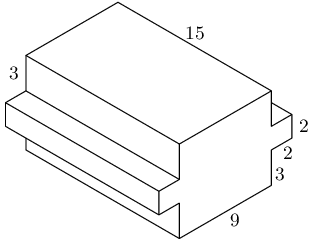

**Solution:**
Let: \(L = 9\), \(B = 8\), \(H = 15\), \(l = 2\), \(b = 2\) and \(h = 15\).

We can view this shape as three rectangular prisms. Two of the three prisms are exactly the same. The
              volume is therefore:

            \begin{align*}
            V &= 2(lbh) + LBH \\
            &= 2((2)(2)(15)) + ((8)(9)(15))\\
            &= 120 + \text{1 080} \\
            &= \text{1 200}
            \end{align*}

For the surface area we have several different rectangles. Each of the smaller prisms has 5 exposed
              rectangles. The larger rectangular prism has 4 rectangles that are not covered up by the smaller prisms.
              The remaining two rectangles are partly covered up by the smaller prisms and so can be considered as 4
              separate rectangles.

We will start by finding the surface area of one of the smaller prisms:

            \begin{align*}
            A_{\text{smaller prism}} & = 2(bl) + 2(bh) + lh \\
            & = 2((2)(2)) + 2((2)(15)) + (2)(15) \\
            & = 98
            \end{align*}

For the larger prism we get:

            \begin{align*}
            A_{\text{larger prism}} & = 2(BH) + 2(BL) + 4(Hx) \\
            & = 2((8)(15)) + 2((9)(15)) + 4((15)(3)) \\
            & = 690
            \end{align*}

Therefore the total surface area is:

            \begin{align*}
            A & = 98 + 98 + 690 \\
            & = 886
            \end{align*}

The volume and surface area are \(\text{1 200}\) and 886 respectively.

Determine the volume of the following:

**Problem:**
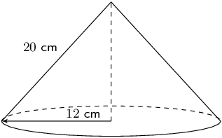

**Solution:**
We first need to find the vertical height (\(H\)):

            \begin{align*}
            H &= \sqrt{(20)^2 - (12)^2}\\
            & = 16
            \end{align*}
            \begin{align*}
            V & = \frac{1}{3} \pi r^2 H\\
            & = \frac{1}{3} \pi (12)^2 (16)\\
            & = 768 \pi \\
            & \approx \text{2 412,743}
            \end{align*}

**Problem:**
\(ABCD\) is a square, \(AC = \text{12}\text{ cm}\), \(AP = \text{10}\text{ cm}\).

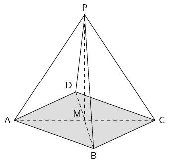

**Solution:**
We first find the vertical height:

            \begin{align*}
            H & = \sqrt{(10)^{2} - (6)^{2}} \\
            & = 8
            \end{align*}

We also need to find the length of the side of the square. To do this we note that triangle \(ABC\) is a
              right-angled isosceles triangle. So we can find the length of the side of the square using the theorem of
              Pythagoras:

            \begin{align*}
            AC^{2} & = AB^{2} + BC^{2} \\
            12^{2} & = 2(AB^{2}) \\
            77 & = AB^{2} \\
            \therefore AB & = \sqrt{77}
            \end{align*}

Now we can find the volume:

            \begin{align*}
            V &= \frac{1}{3} \pi b^2 H \\
            & = \frac{1}{3} \pi (77) (8) \\
            & = \frac{616}{3} \pi \\
            & \approx \text{645,07}\text{ cm$^{3}$}
            \end{align*}

The prism alongside has the following dimensions:

\(AB = 4\) units, \(EC = 8\) units, \(AF = 10\) units. \(BC\) is an arc of a circle with centre \(D\). \(AB
            \parallel EC\).

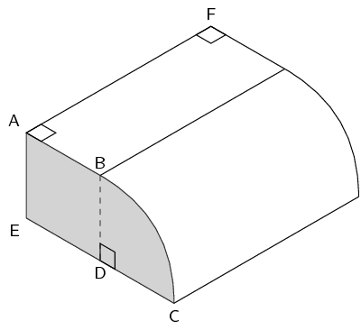

**Problem:**
Explain why \(BD\), the radius of the arc \(BC\), is \(\text{4}\) units.

**Solution:**
Since \(D\) is the centre of the circle \(BD = DC\) (they are both radii of the arc).

\(AB \parallel EC\) and \(BD\) joins \(AB\) and \(EC\), therefore \(AB = ED = 4\text{ units}\).

We also know that \(EC = 8\text{ units}\) and since \(EC = ED + DC\), \(DC = 4 \text{ units}\). Therefore
              \(BD\) is 4 units.

**Problem:**
Calculate the area of the shaded surface.

**Solution:**
We have just calculated that \(BD = 4\). We also know that \(AB = ED = 4\) and so \(ABDE\) is a square
              (\(AB \parallel EC\)). This means that we have the area of a square plus one quarter the area of a circle.

The total area is:

            \begin{align*}
            A & = AB^2 + \frac{1}{4} \pi r^2\\
            & = (4)^2 + \frac{1}{4} \pi (4)^2\\
            & = 16 + 4 \pi \\
            & = \text{28,57} \text{ units}^2
            \end{align*}

**Problem:**
Find the volume of the prism.

**Solution:**
The area of the shaded piece is the area of the base. For the volume we know that we can calculate the
              volume by multiplying the area of the base and the height.

            \begin{align*}
            V &= \text{area of base} \times \text{height} \\
            &= (16 + 4 \pi) \times (10) \\
            & = \text{285,664} \text{ units}^3
            \end{align*}

You can also calculate the volume using the volume of a rectangular prism and one quarter of the volume
              of a cylinder.

A cooldrink container is made in the shape of a pyramid with an isosceles triangular base. This is known as
            a tetrahedron. The angle of elevation of the top of the container is \(\text{33,557}^{\circ}\). \(CI =
            \text{7}\text{ cm}\); \(JI = \text{18}\text{ cm}\).

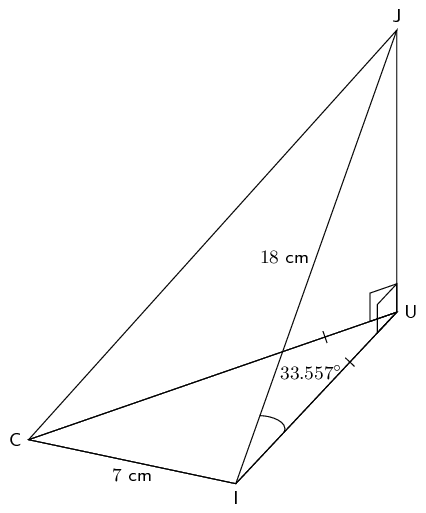

**Problem:**
1. Show that the length \(UI\) is \(\text{15}\) cm.
2. Find the height \(JU\) (to the nearest unit).
3. Calculate the area of \(\triangle CUI\). Hint: construct a perpendicular line from U to \(CI\)
4. Find the volume of the container

**Solution:**
1. \(\triangle UIJ\) is a right-angled triangle. We can use trigonometry to help us find \(UI\). In this case we will use the cosine ratio as we have the hypotenuse (\(JI\)) and are looking for the adjacent side (\(UI\)). \begin{align*} \cos{\text{33,577}^{\circ}} &= \frac{UI}{JI} \\ UI & = 18 \cos{\text{33,577}^{\circ}} \\ &= \text{15}\text{ cm} \end{align*}
2. \(\triangle UIJ\) is a right-angled triangle. We can use trigonometry to help us find \(JU\). In this case we will use the sine ratio as we have the hypotenuse (\(JI\)) and are looking for the opposite side (\(JU\)). \begin{align*} \sin{\text{33,577}^{\circ}} &= \frac{JU}{JI} \\ JU & = 18 \sin{\text{33,577}^{\circ}} \\ &= \text{10}\text{ cm} \end{align*}
3. 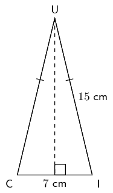 We first find \(h\): \begin{align*} h & = \sqrt{15^2 - \text{3,5}^2} \\ & = \text{14,586} \end{align*} Now we can find the area: \begin{align*} A &= \frac{1}{2} bh \\ &= \frac{1}{2} (\text{3,5})(\text{14,586}) \\ &= \text{25,526}\text{ cm$^{2}$} \end{align*}
4. \begin{align*} V &= \frac{1}{3} \times \frac{1}{2} (bh) \times JU \\ & = \frac{1}{3} \times (\text{25,526}) (\text{9,950}) \\ V & = \text{84,661}\text{ cm$^{3}$} \end{align*}

**Problem:**
The container is filled with the juice such that an \(\text{11,85}\%\) gap of air is left. Determine the
              volume of the juice.

**Solution:**
To find the volume of the juice we need to multiply the total volume of the container by the percentage
              of juice in the container.

            \begin{align*}
            V_j &= V \times (1 - \text{0,1185})\\
            & = \text{0,8815} (\text{84,661}) \\
            V_j & = \text{74,626}\text{ cm$^{3}$}
            \end{align*}

Below is a diagram of The Great Pyramid.

This is a square-based pyramid and \(O\) is the centre of the square.

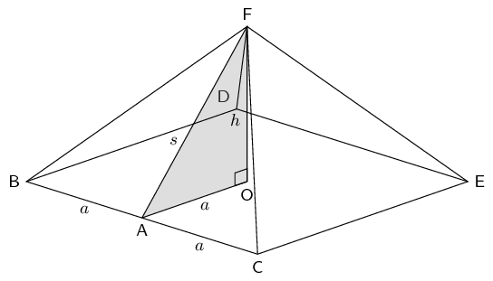

\(BA = AC = a\) and \(OF = h = \text{height of the pyramid}\). The length of the side of the pyramid \(BC =
            \text{755,79}\text{ feet}\) and the height of the pyramid is \(\text{481,4}\) \(\text{feet}\).

**Problem:**
Determine the area of the base of the pyramid in terms of \(a\).

**Solution:**
\begin{align*}
            A & = b^2 \\
            & = (2a)^2 \\
            & = 4a^2
            \end{align*}

**Problem:**
Calculate \(AF (=s)\) to \(\text{5}\) decimal places.

**Solution:**
\begin{align*}
            BC &= 2a \\ \\
            AF & = \sqrt{a^2 + h^2} \\
            & = \sqrt{(\text{0,5}BC)^2 + (OF)^2} \\
            & = \sqrt{(\text{377,895})^2 + (\text{481,4})^2} \\
            & = \text{612,00538}\text{ feet}
            \end{align*}

**Problem:**
From your calculation in question (b) determine \(\dfrac{s}{a}\).

**Solution:**
\begin{align*}
            \frac{s}{a} & = \frac{\text{612,00538}}{\text{377,895}} \\
            & = \text{1,620}
            \end{align*}

**Problem:**
Determine the volume and surface area of the pyramid.

**Solution:**
\begin{align*}
            V &= \frac{1}{3} \pi b^2 H\\
            & = \frac{1}{3} \pi (2a)^2 h \\
            & = \frac{1}{3} \pi (\text{755,79})^2 (\text{481,4}) \\
            & \approx \text{91 661 532,5}\text{ feet$^{3}$}
            \end{align*}
            \begin{align*}
            A &= b(b + 2h_{s})\\
            &= 2a(2a + 2(s)) \\
            &= \text{755,79}(\text{755,79} + \text{1 224,0176}) \\
            & \approx \text{1 551 425,432}\text{ feet$^{2}$}
            \end{align*}

The volume and surface area are: \(\text{91 661 532,5}\) \(\text{feet$^{3}$}\) and
              \(\text{1 551 425,432}\) \(\text{feet$^{2}$}\) respectively.
