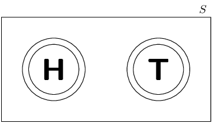
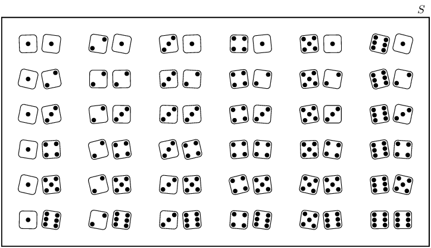
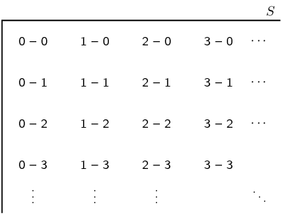
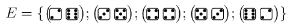

# Chapter 14: Probability

- This chapter covers the use of probability models to compare relative frequency to theoretical probability.
        Venn diagrams are introduced and used to answer probability problems. Intersection, union, mutually exclusive
        events and complementary events are all introduced.
- The difference between theoretical probability and relative frequency should be carefully explained.
- The terminology and usage of language in this section can be confusing, especially to second-language
        speakers. Discuss terminology regularly and emphasise the careful reading of questions.
- Union and intersection symbols have been included, but “and” and “or” is the preferred
        notation in CAPS.
- Make sure to outline the differences between “and”, “or”, “only” and
        “both”. For example, there may be no difference between tea and coffee drinkers and
        tea or coffee drinkers in common speech but in probability, the “and” and
        “or” have very specific meanings. Tea and coffee drinkers refers to the
        intersection of tea drinkers with coffee drinkers, i.e. those who drink both beverages, while tea
        or coffee drinkers refers to the union, i.e. those who drink only tea, those who drink only
        coffee and those who drink both.

We use probability to describe uncertain events. When you accidentally drop a slice of bread, you don't know if
    it's going to fall with the buttered side facing upwards or downwards. When your favourite sports team plays a game,
    you don't know whether they will win or not. When the weatherman says that there is a \(\text{40}\%\) chance of rain
    tomorrow, you may or may not end up getting wet. Uncertainty presents itself to some degree in every event that
    occurs around us and in every decision that we make.

We will see in this chapter that all of these uncertainties can be described using the rules of probability theory
    and that we can make definite conclusions about uncertain processes.

Tracking a superstorm. Meteorologists use computer software to help them track storms
      and predict the weather.

We'll use three examples of uncertain processes to help you understand the meanings of the different words used in
    probability theory: tossing a coin, rolling dice, and a soccer match.

<Callout type="tip" title="Multimedia & Video">
The following video introduces the concepts used in probability.

<VideoPlayer src="https://www.youtube.com/embed/uzkc-qNVoOk" title="Video: 2GVW" />
</Callout>

<Callout type="info" title="Definition: Experiment">
An experiment refers to an uncertain process.
</Callout>

<Callout type="info" title="Definition: Outcome">
An outcome of an experiment is a single result of that experiment.
</Callout>

Experiment 1: A coin is tossed and it lands with either heads (H) or tails (T) facing upwards. An
    example outcome of tossing a coin is that it lands with heads facing up:

Experiment 2: Two dice are rolled and the total number of dots added up. An example outcome of
    rolling two dice:

Experiment 3: Two teams play a soccer match and we are interested in the final score. An example
    outcome of a soccer match:

<Callout type="info" title="Definition: Sample space">
The sample space of an experiment is the set of all possible outcomes of that experiment. The sample space is
        denoted with the symbol \(S\) and the size of the sample space (the total number of possible outcomes) is
        denoted with \(n\left(S\right)\)
</Callout>

Even though we are usually interested in the outcome of an experiment, we also need to know what the other outcomes
    could have been. Let's have a look at the sample spaces of each of our three experiments.

Experiment 1: Since a coin can land in one of only two ways (we will ignore the possibility that
    the coin lands on its edge), the sample space is the set \(S=\left\{\text{H};\text{T}\right\}\). The size of the
    sample space of the coin toss is \(n\left(S\right)=2\):

Experiment 2: Each of the dice can land on a number from \(\text{1}\) to \(\text{6}\). In this
    experiment the sample space of all possible outcomes is every possible combination of the \(\text{6}\) numbers on
    the first die with the \(\text{6}\) numbers on the second die. This gives a total of \(n\left(S\right) = 6 \times 6
    = 36\) possible outcomes. The figure below shows all of the outcomes in the sample space of rolling two dice:

Experiment 3: Each soccer team can get an integer score from \(\text{0}\) upwards. Usually we
    don't expect a score to go much higher than \(\text{5}\) goals, but there is no reason why this cannot happen. So
    the sample space of this experiment consists of all possible combinations of two non-negative integers. The figure
    below shows all of the possibilities. Since we do not limit the score of a team, this sample space is infinitely
    large:

<Callout type="note" title="Note">
When we represent a sample space containing real numbers we can either write out all the outcomes in the sample
      space: \(\{1;2;3;4;5;6;7;8;9;10\}\) or we can represent the sample space as: \(\{ n:n \text{ } \epsilon \text{ }
      \mathbb{Z}, \text{ } 1 \leq n \leq 10 \}\).
</Callout>

<Callout type="info" title="Definition: Event">
An event is a specific set of outcomes of an experiment that you are interested in. An event is denoted with
        the letter \(E\) and the number of outcomes in the event with \(n(E)\).
</Callout>

Experiment 1: Let us say that we would like the coin to land heads up. Here the event contains a
    single outcome: \(E = \left\{\text{H}\right\}\). The size of the event set is \(n(E) = 1\).

Experiment 2: Let us say that we are interested in the sum of the dice being \(8\). In this case
    the event set is:

Experiment 3: We would like to know whether the first team will win. For this event to happen the
    first score must be greater than the second.

\(E=\left\{\left(1;0\right);\left(2;0\right);\left(2;1\right);\left(3;0\right);\left(3;1\right);\left(3;2\right);...\right\}\).
    This event set is infinitely large.

## 14.1 Theoretical probability (EMA7W)

<Callout type="info" title="Definition: Probability">
A probability is a real number between \(\text{0}\) and \(\text{1}\) that describes how likely it is that an
          event will occur.
</Callout>

We can describe probabilities in three ways:

1. As a real number between 0 and 1. For example \(\text{0,75}\).
2. As a percentage. For example \(\text{0,75}\) can be written as \(\text{75}\%\).
3. As a fraction. For example \(\text{0,75}\) can also be written as \(\frac{3}{4}\).

We note the following about probabilities:

- A probability of \(\text{0}\) means that an event will never occur.
- A probability of \(\text{1}\) means that an event will always occur.
- A probability of \(\text{0,5}\) means that an event will occur half the time, or \(\text{1}\) time out of
          every \(\text{2}\).

When all of the possible outcomes of an experiment have an equal chance of occurring, we can compute the exact
      theoretical probability of an event. The probability of an event is the ratio between the number of outcomes in
      the event set and the number of possible outcomes in the sample space.

    \[P\left(E\right)=\frac{n\left(E\right)}{n\left(S\right)}\]

<Callout type="tip" title="Multimedia & Video">
The following video shows an example of calculating the theoretical probabilities of an event.

<VideoPlayer src="https://www.youtube.com/embed/cdRLBOnLTDk" title="Video: 2GVX" />
</Callout>

<Callout type="tip" title="Worked example 1: Theoretical probabilities">
**Question:**
What is the theoretical probability of each of the events in the first two of our three experiments?

**Write down the value of \(n\left(S\right)\):**
Experiment 1 (coin): \(n\left(S\right) = 2\)

Experiment 2 (dice): \(n\left(S\right) = 36\)

**Write down the size of the event set:**
Experiment 1: \(n\left(E\right) = 1\)

Experiment 2: \(n\left(E\right) = 5\)

**Compute the theoretical probability:**
Experiment 1:

        \[P\left(E\right) = \frac{n\left(E\right)}{n\left(S\right)} = \frac{1}{2} = \text{0,5}\]

Experiment 2:

        \[P\left(E\right) = \frac{n\left(E\right)}{n\left(S\right)} = \frac{5}{36} = \text{0,13}\dot{8}\]
</Callout>

Note that we do not consider the theoretical probability of the third experiment. The third experiment is
      different from the first two in an important way, namely that all possible outcomes (all final scores) are not
      equally likely. For example, we know that a soccer score of 1–1 is quite common, while a score of
      11–15 is very, very rare. Because all outcomes are not equally likely, we cannot use the ratio between
      \(n\left(E\right)\) and \(n\left(S\right)\) to compute the theoretical probability of a team winning.

### Textbook Exercise 14.1

**Problem:**
A learner wants to understand the term “event”. So the learner rolls 2 dice hoping to get a
              total of 8. Which of the following is the most appropriate example of the term “event”?

- event set \(= \left\{(4;4)\right\}\)
- event set \(= \left\{(2;6);(3;5);(4;4);(5;3);(6;2)\right\}\)
- event set \(= \left\{(2;6);(6;2)\right\}\)

**Solution:**
We recall the definition of the term “event”:

An event is a specific set of outcomes of an experiment that you are interested in.

Therefore the most appropriate example of the term “event” is event set \(=
              \left\{(2;6);(3;5);(4;4);(5;3);(6;2)\right\}\).

**Problem:**
A learner wants to understand the term “sample space”. So the learner rolls a die. Which of
              the following is the most appropriate example of the term “sample space”?

- \(\{1;2;3;4;5;6\}\)
- \(\{H;T\}\)
- \(\{1;3;5\}\)

**Solution:**
We recall the definition of the term “sample space”:

The sample space of an experiment is the set of all possible outcomes of all experiment.

Therefore the most appropriate example of the term “sample space” is \(\{1;2;3;4;5;6\}\)

**Problem:**
A learner finds a 6 sided die and then rolls the die once on a table. What is the probability that the
              die lands on either 1 or 2?

Write your answer as a simplified fraction.

**Solution:**
\begin{align*}
              n(E) & = \text{number of outcomes in the event set} = \text{2} \\
              n(S) & = \text{number of possible outcomes in the sample space} = \text{6}
              \end{align*}

Finally, we can find the probability:
              \begin{align*}
              P(E) & = \frac{n(E)}{n(S)} \\
              & = \frac{\text{2}}{\text{6}} \\
              & = \dfrac{1}{3}
              \end{align*}

Therefore, the probability that the die lands on either 1 or 2 \(= \frac{1}{3}\).

**Problem:**
A learner finds a textbook that has 100 pages. He then selects one page from the textbook. What is the
              probability that the page has an odd page number?

Write your answer as a decimal (correct to 2 decimal places).

**Solution:**
\begin{align*}
              n(E) & = \text{number of outcomes in the event set} = \text{50} \\
              n(S) & = \text{number of possible outcomes in the sample space} = \text{100}
              \end{align*}

Finally, we can find the probability:
              \begin{align*}
              P(E) & = \frac{n(E)}{n(S)} \\
              & = \frac{\text{50}}{\text{100}} \\
              P(E) & = \text{0,50}
              \end{align*}

Therefore, the probability that the page has an odd page number \(= \text{0,50}\).

**Problem:**
Even numbers from \(\text{2}\) to \(\text{100}\) are written on cards. What is the probability of
              selecting a multiple of \(\text{5}\), if a card is drawn at random?

**Solution:**
There are 50 cards. They are all even.

All even numbers that are also multiples of 5 are multiples of 10: \((10,~ 20, \ldots, 100)\).

There are \(10\) of them.

Therefore, the probability of selecting a card that is a multiple of 5 is \(\frac{10}{50} =
              \frac{1}{5}\).

A bag contains \(\text{6}\) red balls, \(\text{3}\) blue balls, \(\text{2}\) green balls and \(\text{1}\)
              white ball. A ball is picked at random. Determine the probability that it is:

**Problem:**
red

**Solution:**
\begin{align*}
              n(E) & = 6 \\
              n(S) & = 12 \\\\
              P(E) & = \frac{n(E)}{n(S)} \\
              & = \frac{6}{12} \\
              & = \frac{1}{2}
              \end{align*}

**Problem:**
blue or white

**Solution:**
\begin{align*}
              n(E) & = 3 + 1 = 4 \\
              n(S) & = 12 \\\\
              P(E) & = \frac{n(E)}{n(S)} \\
              & = \frac{4}{12} \\
              & = \frac{1}{3}
              \end{align*}

**Problem:**
not green

**Solution:**
\begin{align*}
              n(E) & = 6 + 3 + 1 = 10 \\
              n(S) & = 12 \\\\
              P(E) & = \frac{n(E)}{n(S)} \\
              & = \frac{10}{12} \\
              & = \frac{5}{6}
              \end{align*}

**Problem:**
not green or red

**Solution:**
\begin{align*}
              n(E) & = 3 + 1 = 4 \\
              n(S) & = 12 \\\\
              P(E) & = \frac{n(E)}{n(S)} \\
              & = \frac{4}{12} \\
              & = \frac{1}{3}
              \end{align*}

A playing card is selected randomly from a pack of \(\text{52}\) cards. Determine the probability that it
              is:

**Problem:**
the \(\text{2}\) of hearts

**Solution:**
\begin{align*}
              n(E) & = 1 \\
              n(S) & = 52 \\\\
              P(E) & = \frac{n(E)}{n(S)} \\
              & = \frac{1}{52}
              \end{align*}

**Problem:**
a red card

**Solution:**
Half the deck is red and half the deck is black.

              \begin{align*}
              n(E) & = 26 \\
              n(S) & = 52 \\\\
              P(E) & = \frac{n(E)}{n(S)} \\
              & = \frac{26}{52} \\
              & = \frac{1}{2}
              \end{align*}

**Problem:**
a picture card

**Solution:**
There are \(\text{3}\) picture cards in a suit and \(\text{4}\) suits.

              \begin{align*}
              n(E) & = 12 \\
              n(S) & = 52 \\\\
              P(E) & = \frac{n(E)}{n(S)} \\
              & = \frac{12}{52} \\
              & = \frac{3}{13}
              \end{align*}

**Problem:**
an ace

**Solution:**
There are \(\text{4}\) aces in a pack.

              \begin{align*}
              n(E) & = 4 \\
              n(S) & = 52 \\\\
              P(E) & = \frac{n(E)}{n(S)} \\
              & = \frac{4}{52} \\
              & = \frac{1}{13}
              \end{align*}

**Problem:**
a number less than \(\text{4}\)

**Solution:**
For each suit of \(\text{13}\) cards there are \(\text{3}\) cards less than \(\text{4}\): A,
                \(\text{2}\) and \(\text{3}\).

              \begin{align*}
              n(E) & = 12 \\
              n(S) & = 52 \\\\
              P(E) & = \frac{n(E)}{n(S)} \\
              & = \frac{12}{52} \\
              & = \frac{3}{13}
              \end{align*}
