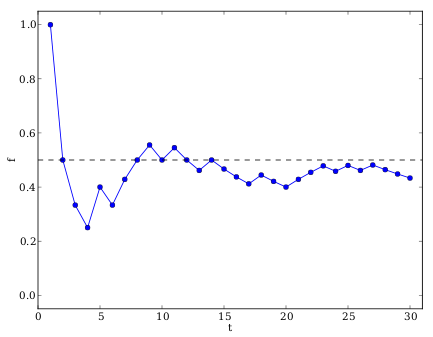

## 14.2 Relative frequency (EMA7X)

<QuizCard id="m10-14-02a" title="Interactive Exercise 14.3" question="A student finds a textbook ( \(\text{100}\) pages) and then selects one page from the textbook. What is the probability that the page number is a multiple of five? INSTRUCTION: Write your answer as a simplified fraction ." options=[] answer="
                    ['1/5', '0.2']
                " hint="You should enter a number here. If you want to, you can use a space to separate thousands.                Example: 12 800,25 For scientific notation you need to use the multiply symbol                ( ∗ ) and the exponent symbol ( ^ ). For example 6,673 × 10 −11 should be written as: 6,673 ∗ 10^−11" explanation="Use the formula for theoretical probability To calculate probability, we first recall the formula: \[\begin{array}{c}P(E) = \frac{n(E)}{n(S)}\end{array}\] Secondly we identify the values for the situation described in the question: \[                     \begin{aligned}                     n(E) & = \text{number of outcomes in the event set} \\                     &= \text{20} \\                     n(S) & = \text{number of possible outcomes in the sample space} \\                     &= \text{100}                     \end{aligned}                 \] Finally, we substitute into the formula and work out the answer. \[                     \begin{aligned}                     P(E) & = \frac{n(E)}{n(S)} \\                     & = \frac{\text{20}}{\text{100}} \\                     P(E) & = \dfrac{1}{5}                     \end{aligned}                 \] Therefore, the probability that the page number is a multiple of five \(=  \dfrac{1}{5}\) . Submit your answer as:" />

<Callout type="info" title="Definition: Relative frequency">
The relative frequency of an event is defined as the number of times that the event occurs during
          experimental trials, divided by the total number of trials conducted.
</Callout>

The relative frequency is not a theoretical quantity, but an experimental one. We have to repeat an experiment a
      number of times and count how many times the outcome of the trial is in the event set. Because it is experimental,
      it is possible to get a different relative frequency every time that we repeat an experiment.

<Callout type="tip" title="Multimedia & Video">
The following video explains the concept of relative frequency using the throw of a dice.

<VideoPlayer src="https://www.youtube.com/embed/5qbMePKrC48?list=PLOaNAKtW5HLRTNORqZN7El2A_brqago9U" title="Video: 2GW7" />
</Callout>

<QuizCard id="m10-14-02b" title="Interactive Exercise 14.4" question="What is the most likely outcome of his next flip?" options=["heads is most likely", "tails is most likely", "both outcomes are equally likely", "impossible to know", "A", "B", "C", "D", "E"] answer=" 2 " hint="" explanation="Use the theoretical probability to determine the answer In this question, Khayone is flipping a coin. He already flipped the coin \(\text{4}\) times. From the list of results we can see that  he got heads \(\text{3}\) times and tails \(\text{1}\) time. The question asks us what is likely to happen in the next flip. The key is to realise that the past outcomes do not change the theoretical probability of the next flip. The theoretical probability for heads and tails is \( \frac{1}{2} \) and that does not change based on earlier outcomes. Since there are more heads than tails in the first \(\text{4}\) flips, it is tempting to think that the next flip is likely to be tails. But that is not true. Even if someone flips a coin and gets heads \(\text{10}\) times in a row, the theoretical probability is still \( \frac{1}{2} \) that the next flip will be heads again. The correct choice from the list is: both outcomes are equally likely . Submit your answer as: both outcomes are equally likely" />

<Callout type="tip" title="Worked example 2: Relative frequency and theoretical probability">
**Question:**
We toss a coin \(\text{30}\) times and observe the outcomes. The results of the trials are shown in the table
          below.

| trial | \(\text{1}\) | \(\text{2}\) | \(\text{3}\) | \(\text{4}\) | \(\text{5}\) | \(\text{6}\) | \(\text{7}\) | \(\text{8}\) | \(\text{9}\) | \(\text{10}\) |
| --- | --- | --- | --- | --- | --- | --- | --- | --- | --- | --- |
| outcome | H | T | T | T | H | T | H | H | H | T |
| trial | \(\text{11}\) | \(\text{12}\) | \(\text{13}\) | \(\text{14}\) | \(\text{15}\) | \(\text{16}\) | \(\text{17}\) | \(\text{18}\) | \(\text{19}\) | \(\text{20}\) |
| outcome | H | T | T | H | T | T | T | H | T | T |
| trial | \(\text{21}\) | \(\text{22}\) | \(\text{23}\) | \(\text{24}\) | \(\text{25}\) | \(\text{26}\) | \(\text{27}\) | \(\text{28}\) | \(\text{29}\) | \(\text{30}\) |
| outcome | H | H | H | T | H | T | H | T | T | T |

What is the relative frequency of observing heads after each trial and how does it compare to the theoretical
          probability of observing heads?

**Count the number of positive outcomes:**
A positive outcome is when the outcome is in our event set. The table below shows a running count (after each
          trial \(t\)) of the number of positive outcomes \(p\) we have observed. For example, after \(t = 20\) trials
          we have observed heads \(\text{8}\) times and tails \(\text{12}\) times and so the positive outcome count is
          \(p = 8\).

| \(t\) | \(\text{1}\) | \(\text{2}\) | \(\text{3}\) | \(\text{4}\) | \(\text{5}\) | \(\text{6}\) | \(\text{7}\) | \(\text{8}\) | \(\text{9}\) | \(\text{10}\) |
| --- | --- | --- | --- | --- | --- | --- | --- | --- | --- | --- |
| \(p\) | \(\text{1}\) | \(\text{1}\) | \(\text{1}\) | \(\text{1}\) | \(\text{2}\) | \(\text{2}\) | \(\text{3}\) | \(\text{4}\) | \(\text{5}\) | \(\text{5}\) |
| \(t\) | \(\text{11}\) | \(\text{12}\) | \(\text{13}\) | \(\text{14}\) | \(\text{15}\) | \(\text{16}\) | \(\text{17}\) | \(\text{18}\) | \(\text{19}\) | \(\text{20}\) |
| \(p\) | \(\text{6}\) | \(\text{6}\) | \(\text{6}\) | \(\text{7}\) | \(\text{7}\) | \(\text{7}\) | \(\text{7}\) | \(\text{8}\) | \(\text{8}\) | \(\text{8}\) |
| \(t\) | \(\text{21}\) | \(\text{22}\) | \(\text{23}\) | \(\text{24}\) | \(\text{25}\) | \(\text{26}\) | \(\text{27}\) | \(\text{28}\) | \(\text{29}\) | \(\text{30}\) |
| \(p\) | \(\text{9}\) | \(\text{10}\) | \(\text{11}\) | \(\text{11}\) | \(\text{12}\) | \(\text{12}\) | \(\text{13}\) | \(\text{13}\) | \(\text{13}\) | \(\text{13}\) |

**Compute the relative frequency:**
Since the relative frequency is defined as the ratio between the number of positive trials and the total
          number of trials,

        \[f=\frac{p}{t}\]

The relative frequency of observing heads, \(f\), after having completed \(t\) coin tosses is:

| \(t\) | \(\text{1}\) | \(\text{2}\) | \(\text{3}\) | \(\text{4}\) | \(\text{5}\) | \(\text{6}\) | \(\text{7}\) | \(\text{8}\) | \(\text{9}\) | \(\text{10}\) |
| --- | --- | --- | --- | --- | --- | --- | --- | --- | --- | --- |
| \(f\) | \(\text{1,00}\) | \(\text{0,50}\) | \(\text{0,33}\) | \(\text{0,25}\) | \(\text{0,40}\) | \(\text{0,33}\) | \(\text{0,43}\) | \(\text{0,50}\) | \(\text{0,56}\) | \(\text{0,50}\) |
| \(t\) | \(\text{11}\) | \(\text{12}\) | \(\text{13}\) | \(\text{14}\) | \(\text{15}\) | \(\text{16}\) | \(\text{17}\) | \(\text{18}\) | \(\text{19}\) | \(\text{20}\) |
| \(f\) | \(\text{0,55}\) | \(\text{0,50}\) | \(\text{0,46}\) | \(\text{0,50}\) | \(\text{0,47}\) | \(\text{0,44}\) | \(\text{0,41}\) | \(\text{0,44}\) | \(\text{0,42}\) | \(\text{0,40}\) |
| \(t\) | \(\text{21}\) | \(\text{22}\) | \(\text{23}\) | \(\text{24}\) | \(\text{25}\) | \(\text{26}\) | \(\text{27}\) | \(\text{28}\) | \(\text{29}\) | \(\text{30}\) |
| \(f\) | \(\text{0,43}\) | \(\text{0,45}\) | \(\text{0,48}\) | \(\text{0,46}\) | \(\text{0,48}\) | \(\text{0,46}\) | \(\text{0,48}\) | \(\text{0,46}\) | \(\text{0,45}\) | \(\text{0,43}\) |

From the last entry in this table we can now easily read the relative frequency after \(\text{30}\) trials,
          namely \(\frac{13}{30} = \text{0,4}\dot{3}\). The relative frequency is close to the theoretical probability
          of \(\text{0,5}\). In general, the relative frequency of an event tends to get closer to the theoretical
          probability of the event as we perform more trials.

A much better way to summarise the table of relative frequencies is in a graph:

The graph above is the plot of the relative frequency of observing heads, \(f\), after having completed \(t\)
          coin tosses. It was generated from the table of numbers above by plotting the number of trials that have been
          completed, \(t\), on the \(x\)-axis and the relative frequency, \(f\), on the \(y\)-axis. In the beginning
          (after a small number of trials) the relative frequency fluctuates a lot around the theoretical probability at
          \(\text{0,5}\), which is shown with a dashed line. As the number of trials increases, the relative frequency
          fluctuates less and gets closer to the theoretical probability.
</Callout>

<Callout type="tip" title="Worked example 3: Relative frequency and theoretical probability">
**Question:**
While watching \(\text{10}\) soccer games where Team 1 plays against Team 2, we record the following final
          scores:

| Trial | \(\text{1}\) | \(\text{2}\) | \(\text{3}\) | \(\text{4}\) | \(\text{5}\) | \(\text{6}\) | \(\text{7}\) | \(\text{8}\) | \(\text{9}\) | \(\text{10}\) |
| --- | --- | --- | --- | --- | --- | --- | --- | --- | --- | --- |
| Team 1 | \(\text{2}\) | \(\text{0}\) | \(\text{1}\) | \(\text{1}\) | \(\text{1}\) | \(\text{1}\) | \(\text{1}\) | \(\text{0}\) | \(\text{5}\) | \(\text{3}\) |
| Team 2 | \(\text{0}\) | \(\text{2}\) | \(\text{2}\) | \(\text{2}\) | \(\text{2}\) | \(\text{1}\) | \(\text{1}\) | \(\text{0}\) | \(\text{0}\) | \(\text{0}\) |

What is the relative frequency of Team 1 winning?

**:**
In this experiment, each trial takes the form of Team 1 playing a soccer match against Team 2.

**Count the number of positive outcomes:**
We are interested in the event where Team 1 wins. From the table above we see that this happens \(\text{3}\)
          times.

**Compute the relative frequency:**
The total number of trials is \(\text{10}\). This means that the relative frequency of the event is

        \[\frac{3}{10} = \text{0,3}\]
</Callout>

It is important to understand the difference between the theoretical probability of an event and the observed
      relative frequency of the event in experimental trials. The theoretical probability is a number that we can
      compute if we have enough information about the experiment. If each possible outcome in the sample space is
      equally likely, we can count the number of outcomes in the event set and the number of outcomes in the sample
      space to compute the theoretical probability.

The relative frequency depends on the sequence of outcomes that we observe while doing a statistical experiment.
      The relative frequency can be different every time we redo the experiment. The more trials we run during an
      experiment, the closer the observed relative frequency of an event will get to the theoretical probability of the
      event.

So why do we need statistical experiments if we have theoretical probabilities? In some cases, like our soccer
      experiment, it is difficult or impossible to compute the theoretical probability of an event. Since we do not know
      exactly how likely it is that one soccer team will score goals against another, we can never compute the
      theoretical probability of events in soccer. In such cases we can still use the relative frequency to estimate the
      theoretical probability, by running experiments and counting the number of positive outcomes.

<Callout type="tip" title="Multimedia & Video">
You can use this Phet simulation on probability to do some
        experiments with dropping a ball through a triangular grid.
</Callout>

### Textbook Exercise 14.2

**Problem:**
A die is tossed 44 times and lands 5 times on the number 3.

What is the relative frequency of observing the die land on the number 3? Write your answer correct to 2
              decimal places.

**Solution:**
Recall the formula:
              \[f = \frac{p}{t}\]

Identify variables needed:
              \begin{align*}
              p & = \text{number of positive trials} = \text{5} \\
              f & = \text{total number of trials} = \text{44}
              \end{align*}

Calculate the relative frequency:
              \begin{align*}
              f & = \frac{p}{t} \\
              & = \frac{\text{5}}{\text{44}} \\
              & = \text{0,11}
              \end{align*}

Therefore, the relative frequency of observing the die on the number 3 is \(\text{0,11}\).

**Problem:**
A coin is tossed 30 times and lands 17 times on heads.

What is the relative frequency of observing the coin land on heads? Write your answer correct to 2
              decimal places.

**Solution:**
Recall the formula:
              \[f = \frac{p}{t}\]

Identify variables needed:
              \begin{align*}
              p & = \text{number of positive trials} = \text{17} \\
              f & = \text{total number of trials} = \text{30}
              \end{align*}

Calculate the relative frequency:
              \begin{align*}
              f & = \frac{p}{t} \\
              & = \frac{\text{17}}{\text{30}} \\
              & = \text{0,57}
              \end{align*}

Therefore, the relative frequency of observing the coin on heads is \(\text{0,57}\).

**Problem:**
A die is tossed 27 times and lands 6 times on the number 6.

What is the relative frequency of observing the die land on the number 6? Write your answer correct to 2
              decimal places.

**Solution:**
Recall the formula:
              \[f = \frac{p}{t}\]

Identify variables needed:
              \begin{align*}
              p & = \text{number of positive trials} = \text{6} \\
              f & = \text{total number of trials} = \text{27}
              \end{align*}

Calculate the relative frequency:
              \begin{align*}
              f & = \frac{p}{t} \\
              & = \frac{\text{6}}{\text{27}} \\
              & = \text{0,22}
              \end{align*}

Therefore, the relative frequency of observing the die on the number 6 is \(\text{0,22}\).
