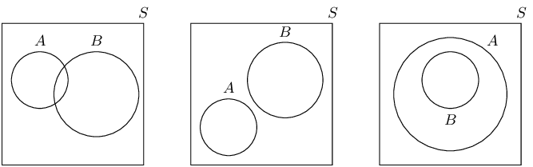
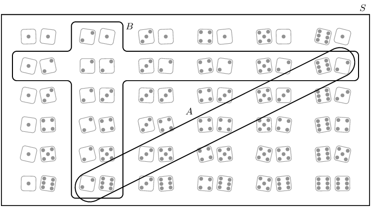
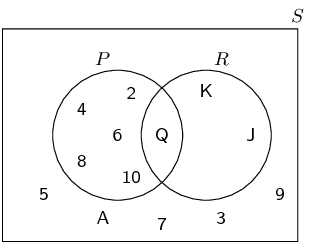
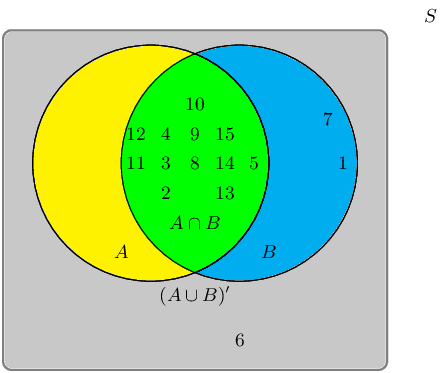
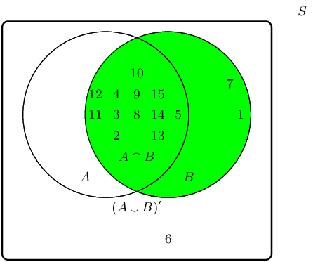
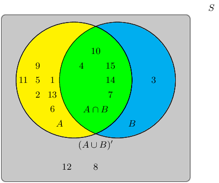
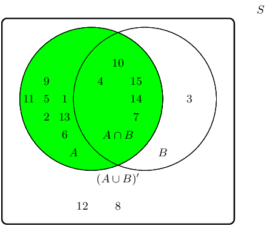
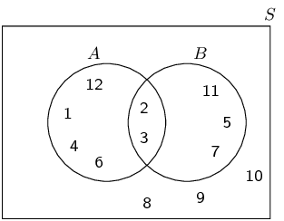
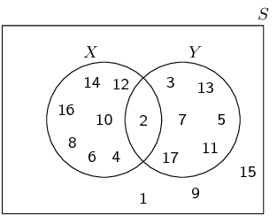
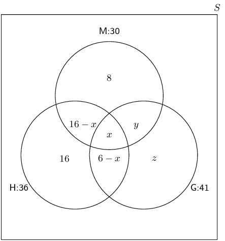

## 14.3 Venn diagrams (EMA7Y)

A Venn diagram is a graphical way of representing the relationships between sets. In each Venn diagram a
                  set is represented by a closed curve. The region inside the curve represents the elements that belong
                  to the set, while the region outside the curve represents the elements that are excluded from the set.

Venn diagrams are helpful for thinking about probability since we deal with different sets. Consider two
                  events, \(A\) and \(B\), in a sample space \(S\). The diagram below shows the possible ways in which
                  the event sets can overlap, represented using Venn diagrams:

The sets are represented using a rectangle for \(S\) and circles for each of \(A\) and \(B\). In the
                  first diagram the two events overlap partially. In the second diagram the two events do not overlap at
                  all. In the third diagram one event is fully contained in the other. Note that events will always
                  appear inside the sample space since the sample space contains all possible outcomes of the
                  experiment.

<Callout type="tip" title="Multimedia & Video">
This video shows how to draw a Venn diagram using a deck of cards as the sample space.

<VideoPlayer src="https://www.youtube.com/embed/obZzOq_wSCg" title="Video: 2GWC" />
</Callout>

You can use an online tool such as this
                              one to generate Venn diagrams.

<QuizCard id="m10-14-03a" title="Interactive Exercise 14.6" question="The number \"7\" is an element of which sets of numbers?" options=["Only A", "Only B", "Both A and B", "Neither A nor B"] answer=" 0 " hint="" explanation="Find out which set or sets \"7\" belongs to The key things about a Venn diagram are: if something is inside a circle in a Venn diagram,                         then it belongs in that group if something is outside a circle in a Venn diagram,                         then it does not belong in that group For example, \"20\" is an element of (belongs in) set \(\mathbb{B}\) because it is inside of the                         yellow circle. In this question, the sets do not share any elements at all: that is why the two circles are not touching each other. From the Venn diagram, we can write each set as a list: \[                         \begin{aligned}                         \mathbb{A} & = \{ 6 \; \, ; 7 \; \, ; 10 \; \, ; 11 \; \, ; 17 \; \, ; 18 \;  \} \\                         \mathbb{B} & = \{ \text{0} \; \, ; 3 \; \, ; 5 \; \, ; 8 \; \, ; 12 \; \, ; 16 \; \, ; 20 \ \}                         \end{aligned}                     \] The element \"7\" is in \(\mathbb{A}\) but not in \(\mathbb{B}\) , so the correct answer is: Only A . Submit your answer as: Only A" />

<Callout type="tip" title="Worked example 4: Venn diagrams">
**Question:**
Represent the sample space of two rolled dice and the following two events using a Venn
                              diagram:

- Event A: the sum of the dice equals \(\text{8}\)
- Event B: at least one of the dice shows 

</Callout>

<Callout type="tip" title="Worked example 5: Venn diagrams">
**Question:**
Consider the set of diamonds removed from a deck of cards. A random card is selected from the
                              set of diamonds.

- Write down the sample space, \(S\), for the experiment.
- What is the value of \(n\left(S\right)\)?
- Consider the following two events: - \(P\): An even diamond is chosen - \(R\): A royal diamond is chosen Represent the sample space \(S\) and events \(P\) and \(R\) using a Venn diagram.

**Write down the sample space S:**
\[S = \left\{A; 2; 3; 4; 5; 6; 7; 8; 9; 10; J; Q; K\right\}\]

**Write down the value of \(n\left(S\right)\):**
\(n\left(S\right) = 13\)

**Draw the Venn diagram:**

</Callout>

### Textbook Exercise 14.3

**Problem:**
A group of learners are given the following Venn diagram:

The sample space can be described as \(\{ n:n \text{ } \epsilon \text{ }
                                          \mathbb{Z}, \text{ } 1 \leq n \leq 15 \}\).

They are asked to identify the event set of \(B\). They get stuck, and you offer
                                          to help them find it.

Which of the following sets best describes the event set of \(B\)?

- \(\{2;3;4;5;8;9;10;11;12;13;14;15\}\)
- \(\{1;2;3;4;5;7;8;9;10;11;12;14;15\}\)
- \(\{1;6;7\}\)
- \(\{6\}\)

**Solution:**
The event set \(B\) can be shaded as follows:

Therefore the event set \(\{1;2;3;4;5;7;8;9;10;11;12;13;14;15\}\) best describes
                                          the event set of \(B\).

**Problem:**
A group of learners are given the following Venn diagram:

The sample space can be described as \(\{ n:n \text{ } \epsilon \text{ }
                                          \mathbb{Z}, \text{ } 1 \leq n \leq 15 \}\).

They are asked to identify the event set of \(A\). They get stuck, and you offer
                                          to help them find it.

Which of the following sets best describes the event set of \(A\)?

- \(\{1;2;3;4;5;6;7;8;9;10;11;12;14;15\}\)
- \(\{3;8;12\}\)
- \(\{3;4;7;10;14;15\}\)
- \(\{1;2;4;5;6;7;9;10;11;13;14;15\}\)
- \(\{4;7;10;14;15\}\)

**Solution:**
The event set \(A\) can be shaded as follows:

Therefore the event set \(\{1;2;4;5;6;7;9;10;11;13;14;15\}\) best describes the
                                          event set of \(A\).

Pieces of paper labelled with the numbers \(\text{1}\) to \(\text{12}\) are
                                          placed in a box and the box is shaken. One piece of paper is taken out and
                                          then replaced.

**Problem:**
What is the sample space, \(S\)?

**Solution:**
\(S = \{ n:n \text{ } \epsilon \text{ } \mathbb{Z}, \text{ } 1 \leq n \leq
                                                12 \}\) or \(S = \{1; 2; \ldots; 12\}\).

**Problem:**
Write down the set \(A\), representing the event of taking a piece of paper
                                                labelled with a factor of \(\text{12}\).

**Solution:**
\(A = \{1; 2; 3; 4; 6; 12\}\).

**Problem:**
Write down the set \(B\), representing the event of taking a piece of paper
                                                labelled with a prime number.

**Solution:**
\(B = \{2; 3; 5; 7; 11\}\).

**Problem:**
Represent \(A\), \(B\) and \(S\) by means of a Venn diagram.

**Solution:**

**Problem:**
Find:

1. \(n(S)\)
2. \(n(A)\)
3. \(n(B)\)

**Solution:**
1. \(\text{12}\)
2. \(\text{6}\)
3. \(\text{5}\)

**Problem:**
Let \(S\) denote the set of whole numbers from \(\text{1}\) to \(\text{16}\),
                                          \(X\) denote the set of even numbers from \(\text{1}\) to \(\text{16}\) and
                                          \(Y\) denote the set of prime numbers from \(\text{1}\) to \(\text{16}\). Draw
                                          a Venn diagram depicting \(S\), \(X\) and \(Y\).

**Solution:**

There are \(\text{71}\) Grade \(\text{10}\) learners at school. All of these take
                                          some combination of Maths, Geography and History. The number who take
                                          Geography is \(\text{41}\), those who take History is \(\text{36}\), and
                                          \(\text{30}\) take Maths. The number who take Maths and History is
                                          \(\text{16}\); the number who take Geography and History is \(\text{6}\), and
                                          there are \(\text{8}\) who take Maths only and \(\text{16}\) who take History
                                          only.

**Problem:**
Draw a Venn diagram to illustrate all this information.

**Solution:**
We are told that \(\text{16}\) learners take Maths and History. Out of
                                                these 16 learners some take Geography as well and some do not.

We are also told that \(\text{6}\) learners take Geography and History. Out
                                                of these 6 learners some take Maths as well and some do not.

Let the number of learners who take Maths, History and Geography \(= x\).
                                                Then we can draw the Venn diagram as follows:

**Problem:**
How many learners take Maths and Geography but not History?

**Solution:**
In the above Venn diagram the number of learners who take Maths and
                                                Geography but not History is indicated by \(y\). To find \(y\) we first
                                                need to determine \(x\).

To find \(x\) we note that the total number of learners who take History is
                                                equal to the sum of each of the following:

- The number of learners who take History only: 16
- The number of learners who take History and Maths but not Geography: \(16 - x\)
- The number of learners who take History and Geography but not Maths: \(6 - x\)
- The number of learners who take all three subjects: \(x\)

                                          \begin{align*}
                                          36 & = 16 + (16 - x) + (6 - x) + x \\
                                          & = 16 + 16 - x + 6 - x + x \\
                                          & = 38 - x \\
                                          \therefore x & = 2
                                          \end{align*}

Now we can find \(y\) using the same method as to find \(x\). This time we
                                                will use the total number of learners who take Maths.

                                          \begin{align*}
                                          30 & = 8 + (16 - x) + x + y \\
                                          & = 8 + 14 + 2 + y \\
                                          & = 24 + y \\
                                          \therefore y & = 6
                                          \end{align*}

Therefore \(\text{6}\) learners take Maths and Geography but not History.

**Problem:**
How many learners take Geography only?

**Solution:**
Now we need to find \(z\). We will use the total number of learners who
                                                take Geography to find \(z\).

                                          \begin{align*}
                                          41 & = (6 - x) + x + y + z \\
                                          & = 4 + 2 + 6 + z \\
                                          & = 12 + z \\
                                          \therefore z & = 29
                                          \end{align*}

Therefore \(\text{29}\) learners take Geography only.

**Problem:**
How many learners take all three subjects?

**Solution:**
When we drew the Venn diagram we let \(x\) be the number of learners that
                                                take all three subjects. We calculated \(x\) in the first question.
                                                Therefore \(\text{2}\) learners take all three subjects.
