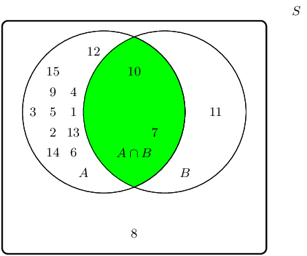
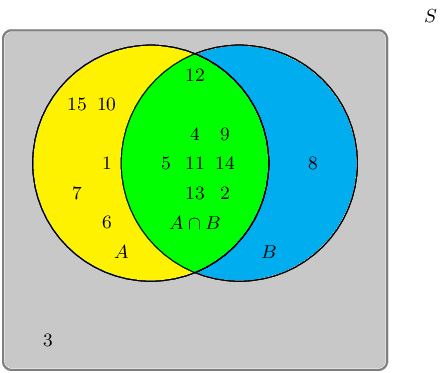
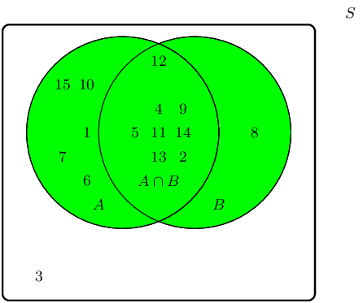

## 14.4 Union and intersection (EMA7Z)

<Callout type="info" title="Definition: Union">
The union of two sets is a new set that contains all of the elements that are in at
                                        least one of the two sets. The union is written as \(A \cup B\) or “\(A
                                        \text{ or } B\)”.
</Callout>

<Callout type="info" title="Definition: Intersection">
The intersection of two sets is a new set that contains all of the elements that are
                                        in both sets. The intersection is written as \(A \cap B\) or “\(A \text{
                                        and } B\)”.
</Callout>

The figure below shows the union and intersection for different configurations of two events in a
                        sample space, using Venn diagrams.

Figure 14.1: The unions and intersections of different events. Note that in the
                                        middle column the intersection, \(A \cap B\), is empty since the two sets do not
                                        overlap. In the final column the union, \(A \cup B\), is equal to \(A\) and the
                                        intersection, \(A \cap B\), is equal to \(B\) since \(B\) is fully contained in
                                        \(A\).

### Textbook Exercise 14.4

**Problem:**
A group of learners are given the following Venn diagram:

The sample space can be described as \(\{ n:n \text{ } \epsilon
                                                        \text{ } \mathbb{Z}, \text{ } 1 \leq n \leq 15 \}\).

They are asked to identify the event set of the intersection between
                                                        event set \(A\) and event set \(B\), also written as \(A \cap
                                                        B\). They get stuck, and you offer to help them find it.

Which set best describes the event set of \(A \cap B\)?

- \(\{7;10;11\}\)
- \(\{1;2;3;4;5;6;7;9;10;11\}\)
- \(\{1;2;3;4;5;6;7;9;10\}\)
- \(\{7;10\}\)

**Solution:**
The intersection between event set \(A\) and event set \(B\), also
                                                        written as \(A \cap B\), can be shaded as follows:

Therefore the event set \(\{7;10\}\) best describes the event set of
                                                        \(A \cap B\).

**Problem:**
A group of learners are given the following Venn diagram:

The sample space can be described as \(\{ n:n \text{ } \epsilon
                                                        \text{ } \mathbb{Z}, \text{ } 1 \leq n \leq 15 \}\)

They are asked to identify the event set of the union between event
                                                        set \(A\) and event set \(B\), also written as \(A \cup B\).
                                                        They get stuck, and you offer to help them find it.

Which set best describes the event set of \(A \cup B\)?

- \(\{1;6;7;10;15\}\)
- \(\{1;2;4;5;6;7;8;9;10;11;12;13;14;15\}\)
- \(\{2;4;5;9;10;11;12;13;14\}\)
- \(\{3\}\)

**Solution:**
The union between event set \(A\) and event set \(B\), also written
                                                        as \(A \cup B\), can be shaded as follows:

Therefore the event set \(\{1;2;4;5;6;7;8;9;10;11;12;13;14;15\}\)
                                                        best describes the event set of \(A \cup B\).
