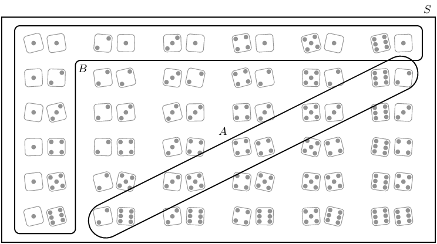

## 14.6 Mutually exclusive events (EMA83)

<QuizCard id="m10-14-06a" title="Interactive Exercise 14.12" question="A group of students have the following Venn diagram, which shows sets \(A\) and \(B\) : The sample space in the diagram below is made of the first \(\text{15}\) natural numbers. The students need to identify the intersection of sets \(A\) and \(B\) , also written as \( \left(A \text { and }  B\right) \) . They get stuck, and you offer to help them find it. Which of the choices below is correct for \(A \text { and }  B\) ?" options=["{1;2;3;5;6;7;8;9;10;11;13;15}", "{1;2;6;7;8;10}", "{1;2;7;8}", "{1;2;3;5;7;8;9;11;13;15}", "{4;6;10;12;14}"] answer="{1;2;3;5;6;7;8;9;10;11;13;15}" hint="" explanation="Locate the intersection on the Venn diagram, and then read off the answer The intersection of two sets only includes the elements which are in both sets. For example, a blue puppy dog would be in the intersection of the set of all dogs and the set of all blue things. The intersection between set \(A\) and set \(B\) , also written as \(A \text { and }  B\) , can be shaded as shown below. All of the numbers in the shaded area belong in \(A \text { and }  B\) . Therefore, the correct choice for \(A \text { and }  B\) is the set {1;2;7;8} . Submit your answer as: {1;2;7;8}" />

<Callout type="info" title="Definition: Mutually exclusive events">
Two events are called mutually exclusive if they cannot occur at the same time. Whenever an outcome
                    of an experiment is in the first event it cannot also be in the second event, and vice versa.
</Callout>

Another way of saying this is that the two event sets, \(A\) and \(B\), cannot have any elements in common,
            or \(P\left(A\cap B\right) = \varnothing\) (where \(\varnothing\) denotes the empty set). We have already
            seen the Venn diagrams of mutually exclusive events in the middle column of the Venn diagrams provided
            earlier.

From this figure you can see that the intersection has no elements. You can also see that the probability of
            the union is the sum of the probabilities of the events.

        \[P\left(A\cup B\right) = P\left(A\right) + P\left(B\right)\]

This relationship is true for mutually exclusive events only.

<QuizCard id="m10-14-06b" title="Interactive Exercise 14.13" question="Fill in the missing word or term for the sentence." options=["certain", "equally likely", "dependent", "independent"] answer="certain" hint="" explanation="Complete the definition For a list of terminology and definitions see the beginning of the Probability chapter in Everything Maths. Two events, \(A\) and \(B\) , are independent if the outcome of the first event does not influence the outcome of the second event. Submit your answer as: independent" />

<Callout type="tip" title="Worked example 7: Mutually exclusive events">
**Question:**
We roll two dice and are interested in the following two events:

- \(A:\) The sum of the dice equals \(\text{8}\)
- \(B:\) At least one of the dice shows 

Show that the events are mutually exclusive.

**Draw the sample space and the two events:**

**Determine the intersection:**
From the above figure we notice that there are no elements in common in A and B. Therefore the events
                    are mutually exclusive.
</Callout>

### Textbook Exercise 14.6

State whether the following events are mutually exclusive or not.

**Problem:**
A fridge contains orange juice, apple juice and grape juice. A cooldrink is chosen at random
                            from the fridge. Event A: the cooldrink is orange juice. Event B: the cooldrink is apple
                            juice.

**Solution:**
We are choosing just one cooldrink from the fridge. This cooldrink cannot be both an orange
                            juice and an apple juice. Therefore these two events are mutually exclusive.

**Problem:**
A packet of cupcakes contains chocolate cupcakes, vanilla cupcakes and red velvet cupcakes. A
                            cupcake is chosen at random from the packet. Event A: the cupcake is red velvet. Event B:
                            the cupcake is vanilla.

**Solution:**
We are choosing just one cupcake from the packet. This cupcake cannot be both a red velvet
                            cupcake and a vanilla one. Therefore these two events are mutually exclusive.

**Problem:**
A card is chosen at random from a deck of cards. Event A: the card is a red card. Event B:
                            the card is a picture card.

**Solution:**
We are choosing just one card from the deck. This card can be both a red card and a picture
                            card. Therefore these two events are not mutually exclusive.

**Problem:**
A cricket team plays a game. Event A: they win the game. Event B: they lose the game.

**Solution:**
The cricket team can either win the game or lose the game. They cannot simultaneously win and
                            lose the game. Therefore these two events are mutually exclusive.

Note that a tie game does not count as either a win or a loss. In a tie neither team can be
                            said to have won the match.
