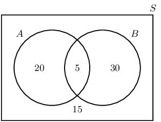
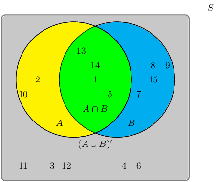
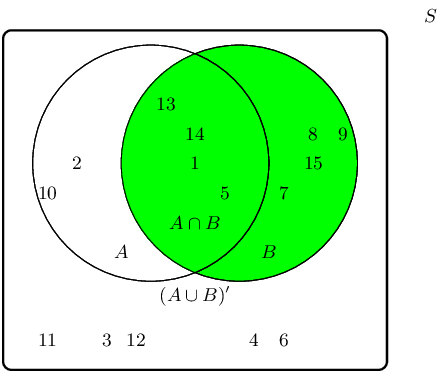
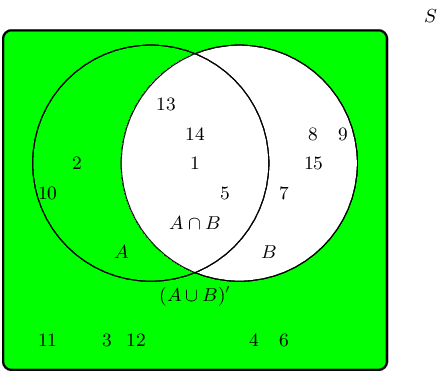
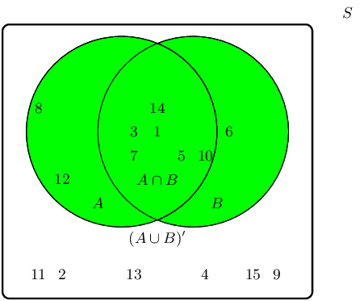
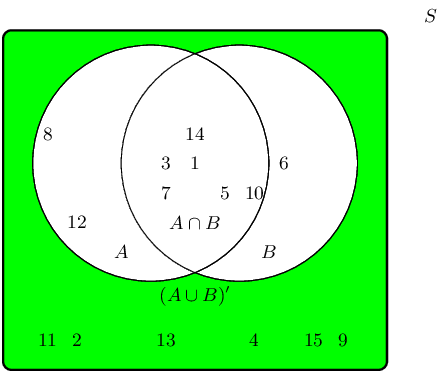
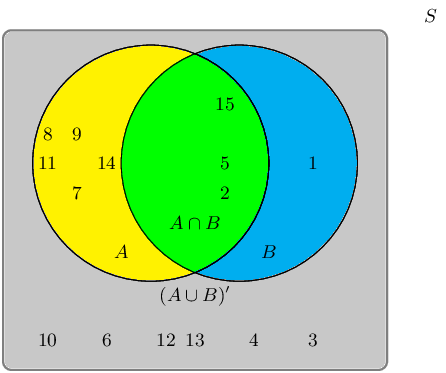
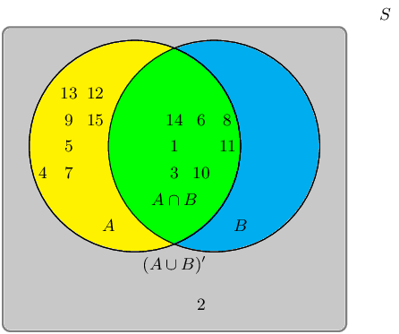

## 14.7 Complementary events (EMA84)

<Callout type="info" title="Definition: Complementary set">
The complement of a set, \(A\), is a new set that contains all of the elements that are not in \(A\). We
          write the complement of \(A\) as \(A'\), or sometimes \(\text{not }\left(A\right)\).
</Callout>

For an experiment with sample space \(S\) and an event \(A\) we can derive some identities for complementary
      events. Since every element in \(A\) is not in \(A'\), we know that complementary events are mutually exclusive.

    \[A \cap A' = \varnothing\]

Since every element in the sample space is either in \(A\) or in \(A'\), the union of complementary events covers
      the sample space.

    \[A \cup A' = S\]

From the previous two identities, we also know that the probabilities of complementary events sum to
      \(\text{1}\).

    \[P\left(A\right) + P\left(A'\right) = P\left(A\cup A'\right) = P\left(S\right) = 1\]

<QuizCard id="m10-14-07a" title="Interactive Exercise 14.15" question="Consider this sample space: \[\begin{array}{c}S = \{ 2; 3; 4; 5; 6; 8; 9; 10 \}\end{array}\] Here is a set in the sample space: \[\begin{array}{c}X = \{  \}\end{array}\] Identify set \( X ' \) . Choose your answer from the list below." options=["{6; 9}", "{2; 3; 4; 5; 8; 9; 10}", "{11; 12; 13; 14; 15; 16; 17; 18}", "\u2205 (the empty set)", "none of the above"] explanation="Refer to the section rules and worked examples to verify." />

<QuizCard id="m10-14-07a" title="Interactive Exercise 14.15" question="For set \(A\) there is a complementary set, which has the name \(A'\) . Choose the best option below about \(A'\) ." options=[] explanation="Refer to the section rules and worked examples to verify." />

<Callout type="tip" title="Worked example 8: Reasoning with Venn diagrams">
**Question:**
In a survey \(\text{70}\) people were questioned about which product they use: A or B or both. The report of
          the survey shows that \(\text{25}\) people use product A, \(\text{35}\) people use product B and \(\text{15}\)
          people use neither. Use a Venn diagram to work out how many people:

1. use product A only
2. use product B only
3. use both product A and product B

**Summarise the sizes of the sample space, the event sets, their union and their intersection:**
- We are told that \(\text{70}\) people were questioned, so the size of the sample space is \(n\left(S\right) = 70\).
- We are told that \(\text{25}\) people use product A, so \(n\left(A\right) = 25\).
- We are told that \(\text{35}\) people use product B, so \(n\left(B\right) = 35\).
- We are told that \(\text{15}\) people use neither product. This means that \(70 - 15 = 55\) people use at least one of the two products, so \(n\left(A\cup B\right) = 55\).

- We are not told how many people use both products, so we have to work out the size of the intersection, \(A \cap B\), by using the identity for the union of two events: \begin{align*} P\left(A \cup B\right) & = P\left(A\right) + P\left(B\right) - P\left(A \cap B\right) \\ \frac{n\left(A \cup B\right)}{n\left(S\right)} & = \frac{n\left(A\right)}{n\left(S\right)} + \frac{n\left(B\right)}{n\left(S\right)} - \frac{n\left(A\cap B\right)}{n\left(S\right)} \\ \frac{55}{70} & = \frac{25}{70} + \frac{35}{70} - \frac{n\left(A\cap B\right)}{70} \\ \therefore n\left(A\cap B\right) & = 25 + 35 - 55 \\ & = 5 \end{align*}

**Determine whether the events are mutually exclusive:**
Since the intersection of the events, \(A \cap B\), is not empty, the events are not mutually exclusive. This
          means that their circles should overlap in the Venn diagram.

**Draw the Venn diagram and fill in the numbers:**

**Read off the answers:**
1. \(\text{20}\) people use product A only.
2. \(\text{30}\) people use product B only.
3. \(\text{5}\) people use both products.
</Callout>

### Textbook Exercise 14.7

**Problem:**
A group of learners are given the following Venn diagram:

The sample space can be described as \(\{ n:n \text{ } \epsilon \text{ } \mathbb{Z}, \text{ } 1 \leq n
              \leq 15 \}\).

They are asked to identify the complementary event set of \(B\), also known as \(B'\). They get stuck,
              and you offer to help them find it.

Which of the following sets best describes the event set of \(B'\)?

- \(\{1;5;13;14\}\)
- \(\{2;3;4;6;10;11;12\}\)
- \(\{3;4;6;11;12\}\)

**Solution:**
The event set \(B\) can be shaded as follows:

The complementary event set \(B'\) can be shaded as follows:

Therefore the event set \(\{2;3;4;6;10;11;12\}\) best describes the complementary event set of \(B\),
              also known as \(B'\).

**Problem:**
A group of learners are given the following Venn diagram:

The sample space can be described as \(\{ n:n \text{ } \epsilon \text{ } \mathbb{Z}, \text{ } 1 \leq n
              \leq 15 \}\).

They are asked to identify the complementary event set of \((A \cup B)\), also known as \((A \cup B)'\).
              They get stuck, and you offer to help them find it.

Which of the following sets best describes the event set of \((A \cup B)'\)?

- \(\{2;4;9;11;13;15\}\)
- \(\{1;3;5;6;7;8;10;12;14\}\)
- \(\{6;8;12\}\)

**Solution:**
The event set \((A \cup B)\) can be shaded as follows:

The complementary event set \((A \cup B)'\) can be shaded as follows:

Therefore the event set \(\{2;4;9;11;13;15\}\) best describes the complementary event set of \((A \cup
              B)\), also known as \((A \cup B)'\).

**Problem:**
Given the following Venn diagram:

The sample space can be described as \(\{ n:n \text{ } \epsilon \text{ } \mathbb{Z}, \text{ } 1 \leq n
              \leq 15 \}\).

Are \((A \cup B)'\) and \(A \cup B\) mutually exclusive?

**Solution:**
We recall the definition of the term “mutually exclusive”:

Two events are called mutually exclusive if they cannot occur at the same time.

The event set for \((A \cup B)'\) is: \(\{3;4;10;12;13\}\)

The event set for \(A \cup B\) is: \(\{1;2;5;6;7;8;9;11;14;15\}\)

The question we must ask: Can they occur at the same time?

By observing both sets, we can identify the following overlapping event set: \(\{\} \text{ or }
              \varnothing\).

Therefore, yes, the event sets \((A \cup B)'\) and \(A \cup B\) are mutually exclusive in this example.

**Problem:**
Given the following Venn diagram:

The sample space can be described as \(\{ n:n \text{ } \epsilon \text{ } \mathbb{Z}, \text{ } 1 \leq n
              \leq 15 \}\).

Are \(A'\) and \(B'\) mutually exclusive?

**Solution:**
We recall the definition of the term “mutually exclusive”:

Two events are called mutually exclusive if they cannot occur at the same time.

The event set for \(A'\) is: \(\{2\}\)

The event set for \(B'\) is: \(\{2;4;5;7;9;12;13;15\}\)

The question we must ask: Can they occur at the same time?

By observing both sets, we can identify the following overlapping event set: \(\{2\}\)

Therefore, no, the event sets \(A'\) and \(B'\) are not mutually exclusive in this example.
