### Textbook Exercise 14.8

**Problem:**
A learner wants to understand the term “outcome”. So the learner rolls a die. Which of the
            following is the most appropriate example of the term “outcome”?

- A teacher walks into the class room.
- The die lands on the number 5.
- The clock strikes 3 pm.

**Solution:**
We recall the definition of the term “outcome”:

An outcome of an experiment is a single result of that experiment

Therefore the most appropriate example of the term “outcome” is: the die lands on the number 5.

**Problem:**
A group of learners are given the following Venn diagram:

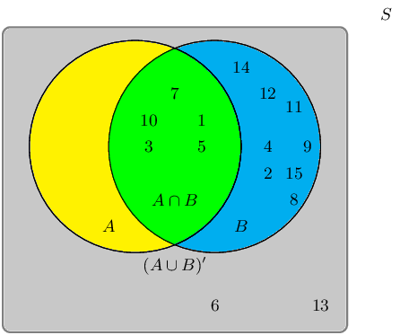

The sample space can be described as \(\{ n:n \text{ } \epsilon \text{ } \mathbb{Z}, \text{ } 1 \leq n \leq
            15 \}\).

They are asked to identify the event set of \(B\). They get stuck, and you offer to help them find it.

Which of the following sets best describes the event set of \(B\)?

- \(\{6;13\}\)
- \(\{1;3;5;7;10\}\)
- \(\{2;4;6;8;9;11;12;13;14;15\}\)
- \(\{1;2;3;4;5;7;8;9;10;11;12;14;15\}\)

**Solution:**
The event set \(B\) can be shaded as follows:

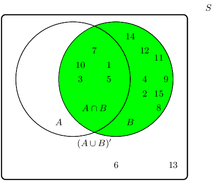

Therefore the event set \(\{1;2;3;4;5;7;8;9;10;11;12;14;15\}\) best describes the event set of \(B\).

**Problem:**
A group of learners are given the following Venn diagram:

The sample space can be described as \(\{ n:n \text{ } \epsilon \text{ } \mathbb{Z}, \text{ } 1 \leq n \leq
            15 \}\).

They are asked to identify the event set of the union between event set \(A\) and event set \(B\), also
            written as \(A \cup B\). They get stuck, and you offer to help them find it.

Write down the event set that best describes \(A \cup B\).

**Solution:**
The union between event set \(A\) and event set \(B\), also written as \(A \cup B\), can be shaded as
            follows:

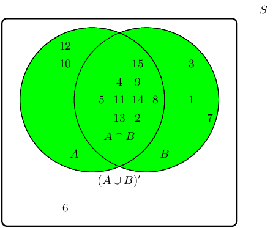

Therefore the event set \(\{1;2;3;4;5;7;8;9;10;11;12;13;14;15\}\) best describes the event set of \(A \cup
            B\).

**Problem:**
Given the following Venn diagram:

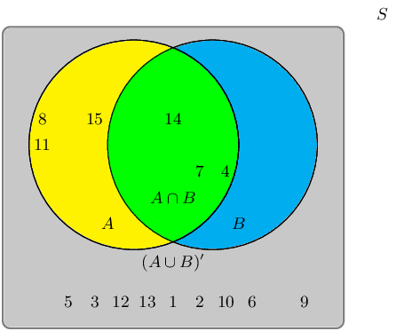

The sample space can be described as \(\{ n:n \text{ } \epsilon \text{ } \mathbb{Z}, \text{ } 1 \leq n \leq
            15 \}\).

Are \(A \cup B\) and \((A \cup B)'\) mutually exclusive?

**Solution:**
We recall the definition of the term “mutually exclusive”:

Two events are called mutually exclusive if they cannot occur at the same time.

The event set for \(A \cup B\) is: \(\{4;7;8;11;14;15\}\).

The event set for \((A \cup B)'\) is: \(\{1;2;3;5;6;9;10;12;13\}\).

The question we must ask: Can they occur at the same time?

By observing both sets, we can identify the following overlapping event set: \(\{\}\)

Therefore, yes, the event sets \(A \cup B\) and \((A \cup B)'\) are mutually exclusive in this example.

**Problem:**
A group of learners are given the following Venn diagram:

The sample space can be described as \(\{ n:n \text{ } \epsilon \text{ } \mathbb{Z}, \text{ } 1 \leq n \leq
            15 \}\).

They are asked to identify the complementary event set of \((A \cap B)\), also known as \((A \cap B)'\).
            They get stuck, and you offer to help them find it.

Write down the set that best describes the event set of \((A \cap B)'\).

**Solution:**
The event set \((A \cap B)\) can be shaded as follows:

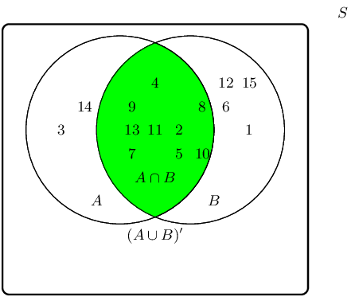

The complementary event set \((A \cap B)'\) can be shaded as follows:

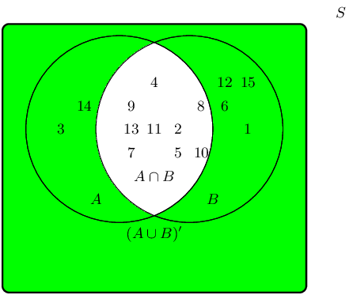

Therefore the event set \(\{1;3;6;12;14;15\}\) best describes the complementary event set of \((A \cap
            B)\), also known as \((A \cap B)'\).

**Problem:**
A learner finds a deck of 52 cards and then takes one card from the deck. What is the probability that the
            card is a king?

Write your answer as a decimal (correct to 2 decimal places).

**Solution:**
\begin{align*}
            n(E) & = \text{number of outcomes in the event set} = \text{4} \\
            n(S) & = \text{number of possible outcomes in the sample space} = \text{52}
            \end{align*}

Finally, we calculate the probability:
            \begin{align*}
            P(E) & = \frac{n(E)}{n(S)} \\
            & = \frac{\text{4}}{\text{52}} \\
            & \approx \text{0,08}
            \end{align*}

Therefore, the probability that the card is a King \(\approx \text{0,08}\).

**Problem:**
A die is tossed 21 times and lands 2 times on the number 3.

What is the relative frequency of observing the die land on the number 3? Write your answer correct to 2
            decimal places.

**Solution:**
Recall the formula:
            \[f = \frac{p}{t}\]

Identify variables needed:
            \begin{align*}
            p & = \text{number of positive trials} = \text{2} \\
            f & = \text{total number of trials} = \text{21}
            \end{align*}

Calculate the relative frequency:
            \begin{align*}
            f & = \frac{p}{t} \\
            & = \frac{\text{2}}{\text{21}} \\
            & = \text{0,10}
            \end{align*}

Therefore, the relative frequency of observing the die on the number 3 is \(\text{0,1}\).

**Problem:**
A coin is tossed 44 times and lands 22 times on heads.

What is the relative frequency of observing the coin land on heads? Write your answer correct to 2 decimal
            places.

**Solution:**
Recall the formula:
            \[f = \frac{p}{t}\]

Identify variables needed:
            \begin{align*}
            p & = \text{number of positive trials} = \text{22} \\
            f & = \text{total number of trials} = \text{44}
            \end{align*}

Calculate the relative frequency:
            \begin{align*}
            f & = \frac{p}{t} \\
            & = \frac{\text{22}}{\text{44}} \\
            & = \text{0,50}
            \end{align*}

Therefore, the relative frequency of observing the coin on heads is \(\text{0,50}\).

**Problem:**
A group of \(\text{45}\) children were asked if they eat Frosties, Strawberry Pops or both. \(\text{31}\)
            children said they eat both and \(\text{6}\) said they only eat Frosties. What is the probability that a
            child chosen at random will eat only Strawberry Pops?

**Solution:**
\begin{align*}
          45(\text{all}) - 6(\text{only Frosties}) - 31 (\text{both}) &= 8 (\text{only Strawberry Pops})\\
          \therefore \frac{8}{45} &=\text{0,18}
          \end{align*}

In a group of \(\text{42}\) learners, all but \(\text{3}\) had a packet of chips or a cooldrink or both. If
            \(\text{23}\) had a packet of chips and \(\text{7}\) of these also had a cooldrink, what is the probability
            that one learner chosen at random has:

**Problem:**
both chips and cooldrink

**Solution:**
\(\frac{7}{42} = \frac{1}{6}\)

**Problem:**
only cooldrink

**Solution:**
Since \(42 - 3 = 39\) learners had at least one, and \(\text{23}\) learners had a packet of chips, then
              \(39 - 23 = 16\) learners only had a cooldrink.

\(\frac{16}{42} = \frac{8}{21}\)

A box contains coloured blocks. The number of each colour is given in the following table.

| Colour | Purple | Orange | White | Pink |
| --- | --- | --- | --- | --- |
| Number of blocks | 24 | 32 | 41 | 19 |

A block is selected randomly. What is the probability that the block will be:

**Problem:**
purple

**Solution:**
Before we answer the questions we first work out how many blocks there are in total. This gives us the
              sample space: \(n(S) = 24 + 32 + 41 + 19 = 116\).

The probability that a block is purple is:

            \begin{align*}
            P(\text{purple}) &= \frac{n(E)}{n(S)}\\
            &= \frac{24}{116}\\
            &= \text{0,21}
            \end{align*}

**Problem:**
purple or white

**Solution:**
The probability that a block is either purple or white is:

            \begin{align*}
            P(\text{purple} \cup \text{white}) &= P(\text{purple}) + P(\text{white}) - P(\text{purple} \cap
            \text{white})\\
            &= \frac{24}{116} + \frac{41}{116} - 0\\
            &= \text{0,56}
            \end{align*}

**Problem:**
pink and orange

**Solution:**
Since one block cannot be two colours the probability of this event is \(\text{0}\).

**Problem:**
not orange

**Solution:**
We first work out the probability that a block is orange:

            \begin{align*}
            P(\text{orange}) &= \frac{32}{116}\\
            &= \text{0,28}
            \end{align*}

The probability that a block is not orange is:

            \begin{align*}
            P(\text{not orange}) & = 1 - \text{0,28}\\
            &= \text{0,72}
            \end{align*}

A small nursery school has a class with children of various ages. The table gives the number of children of
            each age in the class.

|  | 3 years old | 4 years old | 5 years old |
| --- | --- | --- | --- |
| Male | \(\text{2}\) | \(\text{7}\) | \(\text{6}\) |
| Female | \(\text{6}\) | \(\text{5}\) | \(\text{4}\) |

If a child is selected at random what is the probability that the child will be:

**Problem:**
a female

**Solution:**
We calculate the total number of pupils at the school: \(6 + 2 + 5 + 7 + 4 + 6 = 30\).

The total number of female children is \(6 + 5 + 4 = 15\).

The probability of a randomly selected child being female is:

            \begin{align*}
            P(\text{female}) &= \frac{n(E)}{n(S)} \\
            P(\text{female}) & = \frac{15}{30}\\
            P(\text{female}) &= \text{0,5}
            \end{align*}

**Problem:**
a 4 year old male

**Solution:**
The probability of a randomly selected child being a 4 year old male is:

            \begin{align*}
            P(\text{male}) &= \frac{7}{30}\\
            &= \text{0,23}
            \end{align*}

**Problem:**
aged \(\text{3}\) or \(\text{4}\)

**Solution:**
There are \(6 + 2 + 5 + 7 = 20\) children aged \(\text{3}\) or \(\text{4}\). The probability of a
              randomly selected child being either \(\text{3}\) or \(\text{4}\) is: \(\frac{20}{30} = \text{0,67}\).

**Problem:**
aged \(\text{3}\) and \(\text{4}\)

**Solution:**
A child cannot be both \(\text{3}\) and \(\text{4}\), so the probability is \(\text{0}\).

**Problem:**
not \(\text{5}\)

**Solution:**
This is the same as a randomly selected child being either \(\text{3}\) or \(\text{4}\) and so is
              \(\text{0,67}\).

**Problem:**
either \(\text{3}\) or female

**Solution:**
The probability of a child being either \(\text{3}\) or female is:

            \begin{align*}
            P(3 \cup \text{female}) &= P(3) + P(\text{female}) - P(3 \cap \text{female})\\
            &= \frac{8}{30} + \frac{15}{30} - \frac{6}{30}\\
            &= \text{0,56}
            \end{align*}

Fiona has \(\text{85}\) labelled discs, which are numbered from \(\text{1}\) to \(\text{85}\). If a disc is
            selected at random what is the probability that the disc number:

**Problem:**
ends with \(\text{5}\)

**Solution:**
The set of all discs ending with \(\text{5}\) is: \(\{5; 15; 25; 35; 45; 55; 65; 75; 85\}\). This has
              \(\text{9}\) elements.

The probability of drawing a disc that ends with \(\text{5}\) is:

            \begin{align*}
            P(5) &= \frac{n(E)}{n(S)}\\
            P(5) &= \frac{9}{85}\\
            P(5) &= \text{0,11}
            \end{align*}

**Problem:**
is a multiple of \(\text{3}\)

**Solution:**
The set of all discs that are multiples of \(\text{3}\) is:
              \(\{3; 6; 9; 12; 15; 18; 21; 24; 27; 30; 33; 36; 39; 42; 45; 48; 51; 54; 57; 60; 63; 66; 69; 72; 75; 78;
              81; 84\}\).
              This has \(\text{28}\) elements.

The probability of drawing a disc that is a multiple of \(\text{3}\) is:\(P(3_m) = \frac{28}{85} =
              \text{0,33}\).

**Problem:**
is a multiple of \(\text{6}\)

**Solution:**
The set of all discs that are multiples of \(\text{6}\) is: \(\{6; 12; 18; 24; 30; 36; 42; 48; 54; 60;
              66; 72; 78; 84\}\). This set has \(\text{14}\) elements.

The probability of drawing a disc that is a multiple of \(\text{6}\) is: \(P(6_m) = \frac{14}{85} =
              \text{0,16}\).

**Problem:**
is number \(\text{65}\)

**Solution:**
There is only one element in this set and so the probability of drawing \(\text{65}\) is: \(P(65) =
              \frac{1}{85} = \text{0,01}\).

**Problem:**
is not a multiple of \(\text{5}\)

**Solution:**
The set of all discs that are a multiple of \(\text{5}\) is: \(\{5; 10; 15; 20; 25; 30; 35; 40; 45; 50;
              55; 60; 65; 70; 75; 80; 85\}\). This set contains \(\text{17}\) elements. Therefore the number of discs
              that are not multiples of \(\text{5}\) is: \(85 - 17 = 68\).

The probability of drawing a disc that is not a multiple of \(\text{5}\) is: \(P(\text{not multiple of }
              5) = \frac{68}{85} = \text{0,80}\).

**Problem:**
is a multiple of \(\text{3}\) or \(\text{4}\)

**Solution:**
In part b), we worked out the probability for a disc that is a multiple of \(\text{3}\). Now we work out
              the number of elements in the set of all discs that are multiples of \(\text{4}\): \(\{4; 8; 12; 16; 20;
              24; 28; 32; 36; 40; 44; 48; 52; 56; 60; 64; 68; 72; 76; 80; 84\}\). This has \(\text{28}\) elements.

The probability that a disc is a multiple of either \(\text{3}\) or \(\text{4}\) is:

            \begin{align*}
            P(3_m \cup 4_m) &= P(3_m) + P(4_m) - P(3_m \cap 4_m)\\
            & = \frac{1}{3} + \frac{28}{85} - \frac{1}{3} \times \frac{28}{85}\\
            & = \text{0,55}
            \end{align*}

**Problem:**
is a multiple of \(\text{2}\) and \(\text{6}\)

**Solution:**
The set of all discs that are multiples of \(\text{2}\) and \(\text{6}\) is the same as the set of all
              discs that are a multiple of \(\text{6}\). Therefore the probability of drawing a disc that is both a
              multiple of \(\text{2}\) and \(\text{6}\) is: \(\text{0,16}\).

**Problem:**
is number \(\text{1}\)

**Solution:**
There is only \(\text{1}\) element in this set and so the probability is \(\text{0,01}\).

Use a Venn diagram to work out the following probabilities for a die being rolled:

**Problem:**
a multiple of \(\text{5}\) and an odd number

**Solution:**
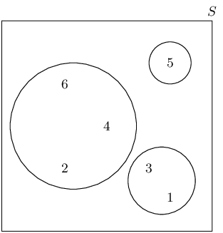

For a die being rolled the sample space is \(\{1; 2; 3; 4; 5; 6\}\)

There is only one possibility here: the die lands on a 5. Therefore the probability is: \(\frac{1}{6}\).

**Problem:**
a number that is neither a multiple of \(\text{5}\) nor an odd number

**Solution:**
There is only one multiple of 5 in the sample space, this is an odd number. Therefore the set of numbers
              that are neither a multiple of 5 nor an odd number is: \(\{2; 4; 6\}\). Therefore the probability is:
              \(\frac{3}{6} = \frac{1}{2}\).

**Problem:**
a number which is not a multiple of \(\text{5}\), but is odd

**Solution:**
There is only one multiple of 5 in the sample space, this is an odd number. Therefore the set of numbers
              that are not a multiple of 5 but is an odd number is: \(\{1; 3\}\). Therefore the probability is:
              \(\frac{2}{6} = \frac{1}{3}\).

**Problem:**
A packet has yellow sweets and pink sweets. The probability of taking out a pink sweet is \(\frac{7}{12}\).
            What is the probability of taking out a yellow sweet?

**Solution:**
\(1 - \frac{7}{12} = \frac{5}{12}\)

In a car park with \(\text{300}\) cars, there are \(\text{190}\) Opels. What is the probability that the
            first car to leave the car park is:

**Problem:**
an Opel

**Solution:**
\(\frac{190}{300} = \frac{19}{30}\)

**Problem:**
not an Opel

**Solution:**
\(1 - \frac{19}{30} = \frac{11}{30}\)

Nezi has \(\text{18}\) loose socks in a drawer. Eight of these are plain orange and two are plain pink. The
            remaining socks are neither orange nor pink. Calculate the probability that the first sock taken out at
            random is:

**Problem:**
orange

**Solution:**
\(\frac{8}{18} = \frac{4}{9}\)

**Problem:**
not orange

**Solution:**
\(1 - \frac{4}{9} = \frac{5}{9}\)

**Problem:**
pink

**Solution:**
\(\frac{2}{18} = \frac{1}{9}\)

**Problem:**
not pink

**Solution:**
\(1 - \frac{1}{9} = \frac{8}{9}\)

**Problem:**
orange or pink

**Solution:**
\(\frac{1}{9} + \frac{4}{9} = \frac{5}{9}\)

**Problem:**
neither orange nor pink

**Solution:**
\(1 - \frac{5}{9} = \frac{4}{9}\)

A plate contains \(\text{9}\) shortbread cookies, \(\text{4}\) ginger biscuits, \(\text{11}\) chocolate
            chip cookies and \(\text{18}\) Jambos. If a biscuit is selected at random, what is the probability that:

**Problem:**
it is either a ginger biscuit or a Jambo

**Solution:**
Total number of biscuits is \(9 + 4 + 11 + 18 = 42\).

            \begin{align*}
            \frac{4}{42} + \frac{18}{42} &= \frac{22}{42}\\
            &=\frac{11}{21}
            \end{align*}

**Problem:**
it is not a shortbread cookie

**Solution:**
\begin{align*}
            1 - \frac{9}{42} &= 1 - \frac{3}{14}\\
            &=\frac{11}{14}
            \end{align*}

\(\text{280}\) tickets were sold at a raffle. Jabulile bought \(\text{15}\) tickets. What is the
            probability that Jabulile:

**Problem:**
wins the prize

**Solution:**
\(\frac{15}{280} = \frac{3}{56}\)

**Problem:**
does not win the prize

**Solution:**
\(1 - \frac{3}{56} = \frac{53}{56}\)

A group of children were surveyed to see how many had red hair and brown eyes. \(\text{44}\) children had
            red hair but not brown eyes, \(\text{14}\) children had brown eyes and red hair, \(\text{5}\) children had
            brown eyes but not red hair and \(\text{40}\) children did not have brown eyes or red hair.

**Problem:**
How many children were in the school?

**Solution:**
The following possibilities exist for the hair and eye colour surveyed. Each of these is mutually
              exclusive:

- A child has brown eyes and red hair.
- A child has brown eyes but not red hair.
- A child has red hair but not brown eyes.
- A child does not have red hair or brown eyes.

Since we are given the total number of children in each of these four groups we can add these together to
              get the total number of children: \(44 + 14 + 5 + 40 = 103\).

**Problem:**
What is the probability that a child chosen at random has:

1. brown eyes
2. red hair

**Solution:**
1. \(\frac{19}{103}\)
2. \(\frac{58}{103}\)

**Problem:**
A child with brown eyes is chosen randomly. What is the probability that this child will have red hair?

**Solution:**
\(\frac{14}{(14 + 5)} = \frac{14}{19}\)

A jar has purple sweets, blue sweets and green sweets in it. The probability that a sweet chosen at random
            will be purple is \(\frac{1}{7}\) and the probability that it will be green is \(\frac{3}{5}\).

**Problem:**
If I choose a sweet at random what is the probability that it will be:

1. purple or blue
2. green
3. purple

**Solution:**
1. Same as not green: \(1 - \frac{3}{5} = \frac{2}{5}\)
2. \(\frac{3}{5}\)
3. \(\frac{1}{7}\)

**Problem:**
If there are \(\text{70}\) sweets in the jar how many purple ones are there?

**Solution:**
\(\frac{1}{7} \times 70 = 10\)

**Problem:**
\(\frac{2}{5}\) of the purple sweets in (b) have streaks on them and the rest do not. How many purple
              sweets have streaks?

**Solution:**
\(10 \times \frac{2}{5} = 4\)

Box A contains \(\text{3}\) cards numbered \(\text{1}\), \(\text{2}\) and \(\text{3}\).

Box B contains \(\text{2}\) cards numbered \(\text{1}\) and \(\text{2}\).

One card is removed at random from each box.

Find the probability that:

**Problem:**
the sum of the numbers is \(\text{4}\).

**Solution:**
\(S = \{(1,1);(1,2);(2,1);(2,2);(3,1);(3,2)\}\)
            \begin{align*}
            P &= \frac{n(E)}{n(S)} \\
            P &= \frac{2}{6} \\
            \therefore P &= \frac{1}{3}
            \end{align*}

**Problem:**
the sum of the two numbers is a prime number.

**Solution:**
\begin{align*}
            P &= \frac{n(E)}{n(S)} \\
            P &= \frac{4}{6} \\
            \therefore P &= \frac{2}{3}
            \end{align*}

**Problem:**
the product of the two numbers is at least \(\text{3}\).

**Solution:**
\begin{align*}
            P &= \frac{n(E)}{n(S)} \\
            P &= \frac{3}{6} \\
            \therefore P &= \frac{1}{2}
            \end{align*}

**Problem:**
the sum is equal to the product.

**Solution:**
\begin{align*}
            P &= \frac{n(E)}{n(S)} \\
            P &= \frac{1}{6}
            \end{align*}

A card is drawn at random from an ordinary pack of \(\text{52}\) playing cards.

**Problem:**
Find the probability that the card drawn is:

1. the three of diamonds
2. the three of diamonds or any heart
3. a diamond or a three

**Solution:**
1. \begin{align*} P &= \frac{n(E)}{n(S)} \\ P &= \frac{1}{52} \end{align*}
2. \begin{align*} P &= \frac{n(E)}{n(S)} \\ &= \frac{14}{52} \\ P &= \frac{7}{26} \end{align*}
3. \begin{align*} P &= \frac{n(E)}{n(S)} \\ P &= \frac{16}{52} \\ P &= \frac{4}{13} \end{align*}

**Problem:**
The card drawn is the three of diamonds. It is placed on the table and a second card is drawn. What is
              the probability that the second card drawn is not a diamond.

**Solution:**
\begin{align*}
            P &= \frac{n(E)}{n(S)} \\
            &= \frac{39}{51} \\
            &= \frac{13}{17}
            \end{align*}

**Problem:**
A group of learners is given the following event sets:

          \[\begin{array}{|l|c|c|}
          \hline
          \text{Event Set } A & 3 & 4 \\
          \hline
          \end{array}\]

          \[\begin{array}{|l|c|c|c|}
          \hline
          \text{Event Set } B & 2 & 4 & 5 \\
          \hline
          \end{array}\]

          \[\begin{array}{|l|c|c|c|c|}
          \hline
          \text{Event Set } A \cup B & 2 & 3 & 4 & 5 \\
          \hline
          \end{array}\]

The sample space can be described as \(\{ n:n \text{ } \epsilon \text{ } \mathbb{Z}, \text{ } 1 \leq n \leq
            6 \}\)

They are asked to calculate the value of \(P(A \cap B)\). They get stuck, and you offer to calculate it for
            them. Give your answer as a decimal number, rounded to two decimal value.

**Solution:**
\[P(A \cup B) = P(A) + P(B) - P(A \cap B)\]

Make \(P(A \cap B)\) the subject, and we get:
            \begin{align*}
            P (A \cap B) & = P(B) + P(A) - P(A \cup B)
            \end{align*}

Identify variables needed:
            \begin{align*}
            P(A) & = \frac{n(A)}{n(S)} = \frac{2}{6} = \text{0,33} \\
            P(B) & = \frac{n(B)}{n(S)} = \frac{3}{6} = \text{0,5} \\
            P(A \cup B) & = \frac{n(A \cup B)}{n(S)} = \frac{4}{6} = \text{0,67}
            \end{align*}

Calculate \(P(A \cap B)\):
            \begin{align*}
            P (A \cap B) & = P(B) + P(A) - P(A \cup B) \\
            & = (\text{0,5}) + (\text{0,33}) - (\text{0,67}) \\
            & = \text{0,17}
            \end{align*}

Therefore, the value of \(P(A \cap B)\) is \(\text{0,17}\).

For each of the following, draw a Venn diagram to represent the situation and find an example to illustrate
            the situation.

**Problem:**
a sample space in which there are two events that are not mutually exclusive

**Solution:**
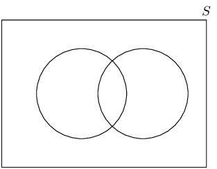

An example is drawing a card from deck of cards. We can draw a red card that is also a picture card.

**Problem:**
a sample space in which there are two events that are complementary

**Solution:**
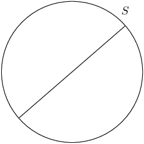

An example is rolling a die. The event of rolling an even number is complementary to the event of rolling
              an odd number.

**Problem:**
Use a Venn diagram to prove that the probability of either event A or B occurring (A and B are not mutually
            exclusive) is given by:

          \[P(A \cup B) = P(A) + P(B) - P(A \cap B)\]

**Solution:**
|  | \(P\left(A\right)\) | \(+\) |  | \(P\left(B\right)\) | \(-\) | \(P\left(A\cap B\right)\) |  |
| --- | --- | --- | --- | --- | --- | --- | --- |
| \(=\) |  | \(+\) | \(\big(\) |  | \(-\) |  | \(\big)\) |
| \(=\) |  | \(+\) |  |  |  |  |  |
| \(=\) |  |  |  |  |  |  |  |
| \(=\) | \(P\left(A\cup B\right)\) |  |  |  |  |  |  |

All the clubs are taken out of a pack of cards. The remaining cards are then shuffled and one card chosen.
            After being chosen, the card is replaced before the next card is chosen.

**Problem:**
What is the sample space?

**Solution:**
\(\{\text{deck without clubs}\}\)

**Problem:**
Find a set to represent the event, \(P\), of drawing a picture card.

**Solution:**
\(P = \{J; Q;K \text{ of hearts, diamonds or spades}\}\)

**Problem:**
Find a set for the event, \(N\), of drawing a numbered card.

**Solution:**
\(N = \{A; 2; 3; 4; 5; 6; 7; 8; 9; 10 \text{ of hearts, diamonds or spades}\}\)

**Problem:**
Represent the above events in a Venn diagram.

**Solution:**
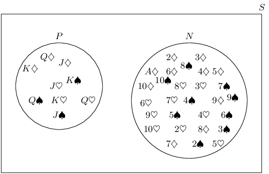

**Problem:**
What description of the sets \(P\) and \(N\) is suitable? (Hint: Find any elements of \(P\) in \(N\) and
              of \(N\) in \(P\).)

**Solution:**
Mutually exclusive and complementary.

A survey was conducted at Mutende Primary School to establish how many of the \(\text{650}\) learners buy
            vetkoek and how many buy sweets during break. The following was found:

- \(\text{50}\) learners bought nothing
- \(\text{400}\) learners bought vetkoek
- \(\text{300}\) learners bought sweets

**Problem:**
Represent this information with a Venn diagram.

**Solution:**
The following Venn diagram represents the given information. However we can calculate more information
              from this that will help us answer the second part of this question.

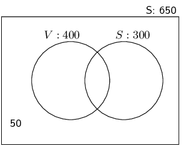

We note the following information:

- 400 learners bought vetkoek, some of these also bought sweets.
- 300 learners bought sweets, some of these also bought vetkoek.
- Of the total number of learners, 50 did not buy anything, so \(650 - 50 = 600\) bought either vetkoek or sweets or both.

Let the number of learners who bought vetkoek only be \(v\), the number of learners who bought sweets
              only be \(s\) and the number of learners who bought both be \(b\). Now we note the following:

            \begin{align*}
            600 & = v + s + b \\
            \text{But } v + b & = 400 \\
            \therefore 600 & = 400 + s \\
            \therefore s & = 200 \\
            \text{Also } s + b & = 300 \\
            \therefore b & = 100 \\
            \therefore v & = 600 - s - b \\
            & = 300
            \end{align*}

We can fill this in on the Venn diagram:

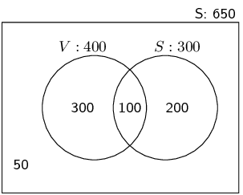

**Problem:**
If a learner is chosen randomly, calculate the probability that this learner buys:

1. sweets only
2. vetkoek only
3. neither vetkoek nor sweets
4. vetkoek and sweets
5. vetkoek or sweets

**Solution:**
1. \(\frac{200}{650} = \text{30,8}\%\)
2. \(\frac{300}{650} = \text{46,2}\%\)
3. \(\frac{50}{650} = \text{7,7}\%\)
4. \(\frac{100}{650} = \text{15,4}\%\)
5. \(\frac{600}{650} = \text{92,3}\%\)

In a survey at Lwandani Secondary School, \(\text{80}\) people were questioned to find out how many read
            the Sowetan, how many read the Daily Sun and how many read both. The survey revealed that \(\text{45}\) read
            the Daily Sun, \(\text{30}\) read the Sowetan and \(\text{10}\) read neither. Use a Venn diagram to find the
            percentage of people that read:

**Problem:**
only the Daily Sun

**Solution:**
The following Venn diagram represents the given information. However we can calculate more information
              from this that will help us answer the problem.

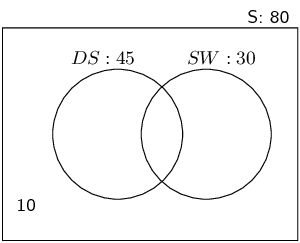

We note the following information:

- 45 people read the Daily Sun, some of these also read the Sowetan.
- 30 people read the Sowetan, some of these also read the Daily Sun.
- Of the total number of people questioned 10 did not read either newspaper, so \(80 - 10 = 70\) read neither.

Let the number of people who read the Daily Sun only be \(d\), the number of people who read the Sowetan
              only be \(s\) and the number of people who read both be \(x\). Now we note the following:

            \begin{align*}
            70 & = d + s + x \\
            \text{But } d + x & = 45 \\
            \therefore 70 & = 45 + s \\
            \therefore s & = 25 \\
            \text{Also } s + x & = 30 \\
            \therefore x & = 5 \\
            \therefore d & = 70 - s - x \\
            & = 40
            \end{align*}

We can fill this in on the Venn diagram:

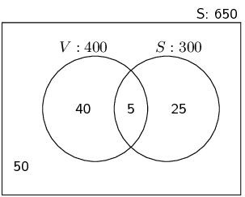

\(\frac{40}{80} = \text{50}\%\).

**Problem:**
only the Sowetan

**Solution:**
\(\frac{25}{80} = \text{31,25}\%\).

**Problem:**
both the Daily Sun and the Sowetan

**Solution:**
\(\frac{5}{80} = \text{6,25}\%\).

**Problem:**
In a class there are

- 8 learners who play football and hockey
- 7 learners who do not play football or hockey
- 13 learners who play hockey
- 19 learners who play football

How many learners are there in the class?

**Solution:**
Let \(H\) and \(F\) be the learners who play hockey and football respectively.

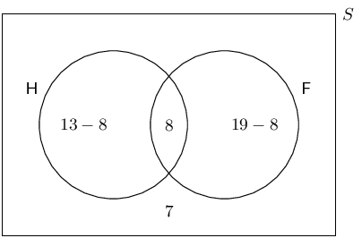

Of \(\text{36}\) people, \(\text{17}\) have an interest in reading magazines and \(\text{12}\) have an
            interest in reading books, \(\text{6}\) have an interest in reading both magazines and books.

**Problem:**
Represent the information in a Venn diagram.

**Solution:**
Let \(B\) and \(M\) be the people who read books and magazines respectively.

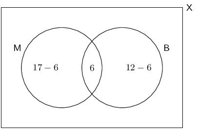

**Problem:**
How many people have no interest in reading magazines or books?

**Solution:**
11 people only read magazines, 6 people only read books and 6 people read both.

The total number of people is 36. Therefore we can find the number of people who have no interest in
              reading magazines or books:

            \[36 - 11 - 6 - 6 = 13\]

**Problem:**
If a person is chosen at random from the group, find the probability that the person will:

1. have an interest in reading magazines and books.
2. have an interest in reading books only.
3. not have any interest in reading books.

**Solution:**
1. \begin{align*} P &= \frac{n(E)}{n(S)} \\ P &= \frac{6}{36} \\ P &= \frac{1}{6} \end{align*}
2. \begin{align*} P &= \frac{n(E)}{n(S)} \\ P &= \frac{6}{36} \\ P &= \frac{1}{6} \end{align*}
3. \begin{align*} P &= \frac{n(E)}{n(S)} \\ P &= \frac{36-12}{36} \\ P &= \frac{24}{36} \\ & = \frac{2}{3} \end{align*}

\(\text{30}\) learners were surveyed and the following information was revealed from this group:

- \(\text{18}\) learners take Geography
- \(\text{10}\) learners take French
- \(\text{6}\) learners take History, but take neither Geography nor French.

In addition the following Venn Diagram has been filled in below:

Let \(G\) be the event that a learner takes Geography.

Let \(F\) be the event that a learner takes French.

Let \(H\) be the event that a learner takes History.

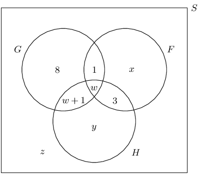

**Problem:**
From the information above, determine the values of \(w\), \(x\), \(y\) and \(z\).

**Solution:**
\begin{align*}
            y & = 6 \\ \\
            8 + (w + 1) + w + 1 &= 18 \\
            2w &= 18 - 10 \\
            w &= 4 \\ \\
            10 & = x + 1 + w + 3 \\
            10 & = x + 8 \\
            x &= 10 - 8 \\
            x &= 2 \\ \\
            z &= 30 - (8 + 1 + w + w + 1 + x + 3 + y) \\
            z &= 30 - (13 + 8 + 2 + 6) \\
            z &= 30 - 29 \\
            z &= 1
            \end{align*}

Therefore \(w = 4\), \(x = 2\), \(y = 6\) and \(z = 1\).

**Problem:**
Determine the probability that a learner chosen at random from this group:

1. takes only Geography.
2. takes French and History, but not Geography.

**Solution:**
1. \begin{align*} P &= \frac{n(E)}{n(S)} \\ &= \frac{8}{30}\\ &= \frac{4}{15} \end{align*}
2. \begin{align*} P &= \frac{n(E)}{n(S)} \\ &= \frac{3}{30}\\ &= \frac{1}{10} \end{align*}
